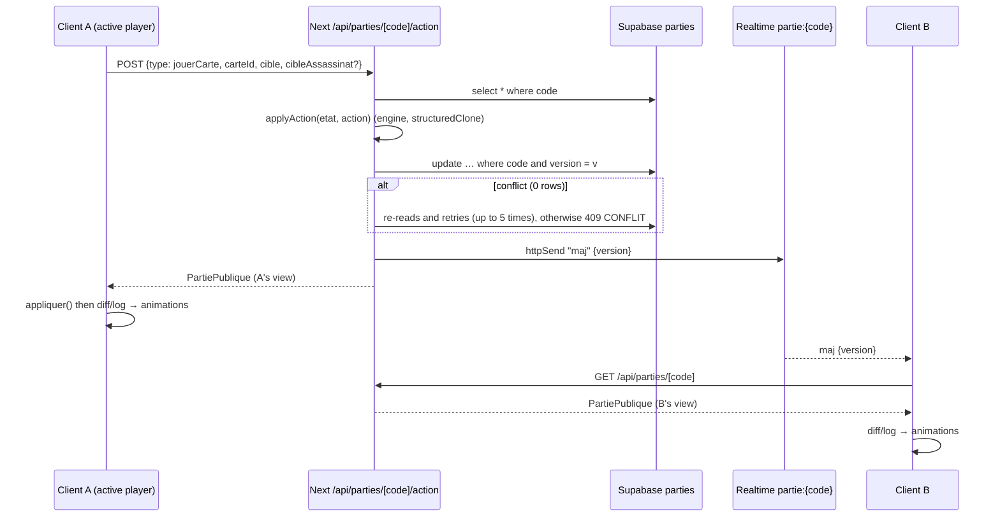

# Courtisans Online: architecture, intentions and pitfalls

This document describes what the code does not say: why it is organized this way, what was tuned by hand, where the pitfalls are, and how to extract reusable `@pbgo/*` building blocks for other card games (Skull King, Flip 7, Love Letter, Hanabi, Skyjo…).

Conventions used in this document:

- `web/…` refers to `games/courtisans/src/…` (the binding package `@pbgo-game/courtisans`). Before PLT-14 these files were in `games/courtisans/apps/web/src/…`, and the document was written before the code was translated to English, so many of them have a new name (`components/jeu3d/` → `components/game3d/`, `components/jeu/` → `components/game/`, `lib/catalogue.ts` → `lib/catalog.ts`, `lib/regles-defaut.ts` → `lib/default-rules.ts`…) or now live in `@pbgo/core` (`packages/core`, see the last column of §7) or in the app's routes (`apps/web/src/app`)
- `engine/…` refers to `games/courtisans/packages/engine/src/…`
- `studio/…` refers to `games/courtisans/apps/studio/…`
- Function names are in backticks and followed by `()`. Leva settings are cited with their folder ("Deck", "Draw Pile"…).
- The Courtisans code is **in French** (identifiers, files, `/api/parties` routes). The template and `@pbgo/core` are **in English** (`/api/games`, `players`, `view`). All of section 7 is about this gap.

State at the time of writing (commit `392e07b`): the web side was still a standalone app, `games/courtisans/apps/web`, importing `@courtisans/engine`; only the engine was wired to `@pbgo/engine-kit` via `engine/game.ts` (`GAME`), and the app did not use `@pbgo/core` yet. Since then (PLT-14) the web side is the binding `@pbgo-game/courtisans` (`games/courtisans/src`) on top of `@pbgo/core`, served by the repository's single Next.js app, `apps/web`. Sections 6.2, 7 and 8 still describe the migration as it stood then.

---

## Contents

1. [Overview](#1-overview)
2. [Engine](#2-engine)
3. [Server and realtime](#3-server-and-realtime)
4. [3D scene](#4-3d-scene)
5. [UI outside the 3D scene](#5-ui-outside-the-3d-scene)
6. [Sanity](#6-sanity)
7. [Generic / configurable / specific classification and proposed API](#7-classification-and-proposed-api)
8. [Technical debt and pitfalls](#8-technical-debt-and-pitfalls)

---

## 1. Overview

### 1.1 Principles

- **The server is the only source of truth.** The full state (`GameState`, including the draw pile, hands and everyone's missions) lives in the `etat` column of the Supabase table `parties`. It is never sent to the client. Each player receives only `vueJoueur(etat, joueurId)` (`engine/view.ts`).
- **The rules live only in the engine** (`packages/engine`, pure TypeScript, no React or Next). The client only *pre-filters* what is clickable (`zonesDisponibles` comes from the view). It validates nothing.
- **Realtime is a simple "ping".** After each write, the server broadcasts `maj {version}` on the channel `partie:{code}`, then each client issues a new `GET`. No game data goes through the channel.
- **Sanity is a content catalog** (images, texts, missions), never a source of rules, with one exception: the **mission conditions** are modeled in Sanity, then converted into the engine's `Condition` (`web/server/missions.ts`, `versCondition()`).
- **Everything has a local default value.** If Sanity goes down, `getCatalogueClient()` returns `CATALOGUE_PAR_DEFAUT` (assets in `web/public`) and `chargerMissions()` tops up the missions with `MISSIONS_PROVISOIRES`. The game stays playable without Sanity.

### 1.2 Player journey, step by step

#### Home (`/`)

| Layer | What happens |
|---|---|
| Client | `web/app/page.tsx` (RSC, `revalidate = 60`, JSON-LD `VideoGame`) renders `Accueil` (`web/components/accueil/accueil.tsx`). The profile comes from `useProfil()` (`web/lib/profil.ts`, `useSyncExternalStore` on the localStorage key `courtisans:profil`, i.e. `{pseudo, chateau}`). The field « Vôtre prénommée » (`ChampAppellation`, `web/components/banquet/ecran-banquet.tsx`) uppercases its input and truncates it to 20 characters. The code is entered in `ChampCode` (InputOTP, 6 boxes, `REGEXP_ONLY_DIGITS_AND_CHARS`). The single button « Courtiser au banquet » calls `courtiser()`: **empty code → creation**, 6-character code → `router.push('/partie/CODE')`, otherwise an error toast. |
| Server | `creer()` → `api.creer(profil)` → `POST /api/parties` → `creerPartie()` (`web/server/parties.ts`): generates a code (`web/server/code.ts`, 6 characters without I/O/0/1), sets the player cookie (`web/server/joueur.ts`, `courtisans_joueur`, UUID, 30 days, httpOnly) and inserts the row (5 attempts on a `23505` collision). |
| Supabase | `insert` into `parties` (`statut = 'lobby'`, `joueurs = [hôte]`, `etat = null`, `version = 0`). |
| Sanity | `getCatalogueClient()` is called by `web/app/layout.tsx` **and** by `page.tsx` (Next cache `revalidate: 60`, tag `catalogue`, `web/sanity/catalogue.ts`). It provides the logo, the banquet backdrop, the Queen, the pattern and the paper (CSS variables `--image-motif` / `--image-papier` set on `<html>`), and the rules. |
| Other | After creation, the link is copied to the clipboard (`lienPartie()`, `web/lib/api.ts`) with the toast « Lien du banquet copié ! ». `EcranOrdinateur` (`web/components/ecran-ordinateur.tsx`) covers the whole screen below 900 px: **the game is not playable on mobile**, by design. |

#### Joining (`/partie/[code]`)

| Layer | What happens |
|---|---|
| Client | `web/app/partie/[code]/page.tsx` uppercases the code, sets `robots: noindex` and renders `PartieClient` (`web/components/partie/partie-client.tsx`). `usePartie(code)` (`web/lib/use-partie.ts`) loads the game. A small `autoJoin` state machine (`idle` → `encours` → `echec` \| `manuel`) decides: if I am not a member (`partie.moiId === null`), the game is in the lobby **and I already have a valid saved profile**, I join automatically. Otherwise (`manuel`), I get the form « Rejoindre le banquet ». |
| Server | `POST /api/parties/[code]/rejoindre`: adds the player, or **updates their profile** if they are already in the lobby. Refused if the game is no longer in the lobby or if it is full (`MAX_JOUEURS = 5`, `web/lib/partie-types.ts`). |
| Supabase | `modifierPartie()` (optimistic lock, see §3), then broadcast `maj`. |
| Sanity | Nothing beyond the home page. |

Error screens, all in `EcranBanquet`: game not found, « Ce banquet a déjà commencé » (non-member and status ≠ lobby), and a loader while `!pret || doitAutoJoin`.

#### Lobby

| Layer | What happens |
|---|---|
| Client | `ListeConvives` (`web/components/partie/lobby.tsx`): seat color `COULEURS_JOUEURS[i]`, host crown (`Couronne`, CSS mask on `/pictograms/PICTOGRAM_NOBLE.webp`), « (vous) ». `BoutonLobby`: only the host sees « Ouvrir le banquet », enabled from `MIN_JOUEURS = 2`. `ChampCode` read-only, with a button to copy the link. |
| Server | `POST …/lancer`: host only, at least 2 players. `chargerMissions()` then `setupPartie()` (`engine/setup.ts`), `statut = 'jeu'`. `POST …/quitter` is only possible in the lobby; if the host leaves, the next player becomes the host. |
| Supabase | Writes `etat`, `statut`, `version + 1`; broadcast. |
| Sanity | `chargerMissions()` (`web/server/missions.ts`) reads the Sanity missions **server-side**, discards those whose condition is invalid and tops up each color with `MISSIONS_PROVISOIRES` up to the number of players. |

#### Reading the missions (opening)

**The banquet waits for all players.** `setupGame()` starts in `phase: "missions"`; each player sends `readMissions` (flag `missionsRead`, idempotent) and the game moves to `"playing"` when the **last** player has read, in the same write: it is this phase change, received by everyone, that closes the opening and triggers the banquet announcement. As long as the phase is `"missions"`, `playCard` is refused (`INVALID_PHASE`) and `activePlayerId` is `null`; `firstPlayerId` already identifies the first player (crown). Current names in the code (this document still uses the old French names): `lireMissions` = `readMissions`, `missionsLues` = `missionsRead`, `jeu` = `playing`. Games saved before this rule stayed in `"playing"`: a player's late read there only records their flag, with nothing to wait for.

**Player who does not confirm.** If the game has not progressed for the inactivity timeout (`turnTimeout`, 60 s by default, Admin › Mechanics, the same one as for an absent player), the players who are already ready see « En attente de X… » at the top of the screen and a button « Commencer sans attendre (n/N) » (`StalledOpening`, `components/game/stalled-opening.tsx`). The vote of **all** the ready players is required (N = number of ready players): `POST /api/games/[code]/banquet` (`app/api/games/[code]/banquet/route.ts`, checks everything server-side: player ready, timeout elapsed) records the votes in `takeover_votes` (stale as soon as a further player confirms, which restarts the timeout); the last vote calls the engine's `startWithoutWaiting()`, which counts the stragglers as having read (they find their missions on the table). If a player who was already ready has left, the vote cannot succeed.

| Layer | What happens |
|---|---|
| Client | `Jeu3D` (`web/components/jeu3d/jeu3d.tsx`): `aLire(vue)` = game not over, I am a player and `missionsLues` is false. The `etape` state goes through `"tapis"` (the mat unrolls, `dureeTapis` 3.2 s + 0.3 s) → `"distribution"` (cards dealt one by one, `0,1 + n×3×pasDistribution` s + 1.3 s) → `"missions"` (missions facing the camera; the `texteBoutonMissions` button appears after `attenteBouton` = 1.6 s) → `null`. The timers only start after `onPret` (the Canvas is mounted). Clicking the button (`confirmMissions()`) sends `readMissions` (button busy while sending, error message if saving fails); the button then becomes « En attente des autres joueurs (n/N) ». Nothing is announced on click: the banquet (and « C'est votre tour » if it is my turn) is announced only when the phase changes from `missions` to `playing`, for everyone at the same time. |
| Server | `POST …/action {type: "lireMissions"}` → `applyAction()` → `missionsLues = true`. |
| Supabase | Write and broadcast. **All players send this action almost at the same time** (see §3.3 and §8). |
| Sanity | Texts `texts.missionsButton`, `texts.banquetStarts`, `texts.guestsSettling`; mission images (`catalogue.missions[id]`) composed with their text on a canvas (`composerMission()`, `web/components/jeu3d/textures.ts`). |

Until everyone has confirmed, nobody can play (phase `missions`): the crown and the banner indicate the first player after the deal (`tourAffiche` is `null` during `tapis`/`distribution`).

#### Playing

| Layer | What happens |
|---|---|
| Client | Selecting a card from the hand (`it.selectionner`), then choosing a target: top/bottom column of the table (`Cible`), own or opponent's domain (`ZoneCliquable`, nickname `Badge`, click on a card of the domain). For an Assassin, a second step "choose the victim" (`Assassinat`) opens, with the button « Ne pas assassiner ». Sending goes through `api.action(code, {type: "jouerCarte", carteId, cible, cibleAssassinat?})`. |
| Server | `POST …/action` only accepts `lireMissions` and `jouerCarte`. `modifierPartie()` → `applyAction()`. The SQL `statut` is recomputed from `etat.phase` (`fin` → `'fin'`). |
| Supabase | Write, `version + 1`, broadcast; the other clients issue a new `GET`. |
| Sanity | Nothing dynamic: the textures are already loaded. |

#### Game over

| Layer | What happens |
|---|---|
| Client | `vue.phase === "fin"` and `vue.resultats` present → `useSequenceFin()` (`web/components/jeu3d/fin.ts`) plays a choreography of about 20 s (see §4.4) that can be skipped (« Passer »). Then come the victory announcement (`annonceVainqueur()`), then the `FinDePartie` scoreboard (`web/components/jeu/fin-de-partie.tsx`) with the sharing thumbnail. |
| Server | `finirTour()` sets `phase = "fin"` and pushes `finDePartie`; the route sets the SQL status to `'fin'`. `vueJoueur()` then reveals everyone's missions, the Spies and `resultats` (`calculerResultats()`). |
| Supabase | `statut = 'fin'`. |
| Sanity | `texts.winnerPhrases` (phrase chosen by a deterministic hash of `code + journal.length`, so that everyone sees the same one). |

#### Play again

| Layer | What happens |
|---|---|
| Client | Button « Rejouer (x/n) » in `FinDePartie` → `api.rejouer()`. The button is disabled if I have already voted. |
| Server | `web/app/api/parties/[code]/rejouer/route.ts`: idempotent vote. When everyone has voted: `setupPartie({joueurs, missions})`, `statut = 'jeu'`, `rejouer = []`. |
| Supabase | New `etat` in the same row (same code, same link). |
| Sanity | `chargerMissions(MAX_JOUEURS)` is called **on every vote**, not only on the last one. |

On the client side, the switch to a new game is detected by the "marker" `phase:joueurActif:aLire` in `Jeu3D`: when `aLire` becomes true again, `etape` goes back to `"tapis"` and the full opening is replayed.

### 1.3 Data flow diagram

```
                       ┌────────────────────────── Sanity (project 2lo2f5sv / production) ──┐
                       │ interface · game · rules · texts · family · role · courtier · mission│
                       └──────────────┬───────────────────────────────┬───────────────────────┘
                   GROQ CATALOGUE_QUERY│ (revalidate 60, tag catalogue) │  GROQ missions (server)
                                      ▼                               ▼
┌───────────── Browser ──────────────┐        ┌──────────── Next.js (Vercel) ─────────────────┐
│ layout/page RSC → CatalogueClient  │◀──HTML─│ getCatalogueClient()  (web/sanity/…)          │
│                                    │        │                                               │
│ usePartie(code)                    │──GET──▶│ /api/parties/[code]  → partiePublique()       │
│   ├─ applies if version > local    │◀─JSON──│      vueJoueur(etat, cookie)                  │
│   ├─ poll 8 s, refetch on focus    │        │                                               │
│   └─ broadcast chan. partie:{code} │        │ POST /api/parties/[code]/action|lancer|…      │
│         "maj {version}" ───────────┼─┐      │   modifierPartie(): reads → applyAction()     │
│                                    │ │      │   → update … where version = v (5 attempts)   │
│ Jeu3D / Scene3D (R3F)              │ │      │   → notifier(): httpSend("maj")               │
│   diff previous / new view         │ │      └──────────────┬───────────────▲────────────────┘
│   + log → animations, sounds       │ │                     │ service role  │
└────────────────────────────────────┘ │                     ▼               │
              ▲                        │      ┌──────────── Supabase ────────┴─────────────────┐
              └────── Realtime ────────┴──────│ table parties (RLS without policy)             │
                 (anon/publishable key,        │ Realtime broadcast (no postgres_changes)       │
                  broadcast only)              └────────────────────────────────────────────────┘
```

Sequence of a move:



---

## 2. Engine

Package `packages/engine` (`@courtisans/engine`), tested with Vitest (`*.test.ts`, including `simulation.test.ts`, which plays entire games). No runtime dependency, except `@pbgo/engine-kit` for the `game.ts` adapter.

### 2.1 Data (`engine/types.ts`, `engine/deck.ts`)

- `FAMILLES`: `papillon, crapaud, rossignol, lievre, cerf, carpe` (6). `ROLES`: `noble, espion, assassin, garde`.
- `Courtisan = { id, famille, role: Role | null }`. Stable id: `${famille}-${role ?? "courtisan"}-${i}`. **It is also used as a React key and as an animation key**; never make it random.
- Composition per family (`deck.ts`): Noble ×4, Spy ×2, Assassin ×2, Guard ×3, no role ×4, i.e. 15 cards per family and **90 cards**.
- `CARTES_ECARTEES = {2: 30, 3: 18, 4: 6, 5: 0}`: cards removed face down depending on the number of players (`ecartees`).
- `TAILLE_MAIN = 3`, `POINTS_MISSION = 3`, `poids(carte)` = 2 for a Noble, 1 otherwise.
- `Niveau = "haut" | "bas"` (the light half / the disgrace half of the mat), `Statut = "lumiere" | "disgrace" | "neutre"`.
- `ZoneJeu = "table" | "domaine" | "domaineAdverse"`: the three "slots" a player must fill each turn, one of each.
- `Cible = {zone: "table", niveau} | {zone: "domaine", joueurId}`. The opponent's domain is a `domaine` with a different `joueurId`; the distinction is made in `zoneDeCible()`.
- `GameState`: `joueurs[]` (`main`, `domaine`, `missions` [1 white + 1 blue], `missionsLues`), `pioche`, `ecartees`, `eliminees`, `table: Placement[]` (`{carte, niveau}`; the **column is not stored**, it is derived from the family), `joueurActif` (index), `zonesJouees: ZoneJeu[]`, `numeroTour`, `phase`, `journal: Evenement[]`.
- `Evenement`: `carteJouee {joueurId, carte, cible}`, `carteEliminee {joueurId, carte, cible}` (the `joueurId` is the assassin), `pioche {joueurId, nombre}`, `finDePartie`.

### 2.2 Setup (`engine/setup.ts`, `setupPartie()`)

1. Shuffle (injectable RNG, `engine/rng.ts`; `GAME.setup` passes `createRng(seed)` if a `seed` is provided).
2. Remove `CARTES_ECARTEES[n]` cards.
3. Deal 3 cards to each player.
4. Draw one white and one blue mission per player. At least `n` missions of each color are required, otherwise `EngineError("MISSIONS_INSUFFISANTES")`, hence the top-up on the server side.
5. Random `joueurActif`.
6. **`phase: "missions"`**: the game waits for all players to read before moving to `playing` (see §1.2).

### 2.3 Turn and rules (`engine/actions.ts`)

`applyAction(state, action)` always starts with a `structuredClone(state)`: the engine is **pure** with respect to its caller, which lets `modifierPartie()` retry without side effects.

- `lireMissions(joueurId)`: refused once the game is over; `missionsLues = true`; if everyone has read, `phase = "jeu"` (no effect today, the phase already has that value).
- `jouerCarte(joueurId, carteId, cible, cibleAssassinat?)`, in order:
  1. phase `jeu`, otherwise `PHASE_INVALIDE`;
  2. the player is the active player, otherwise `PAS_TON_TOUR`;
  3. the card is in their hand, otherwise `CARTE_INCONNUE`;
  4. `zoneDeCible()`; the zone has not already been played this turn, otherwise `ZONE_DEJA_JOUEE`;
  5. `cibleAssassinat` is only accepted for an Assassin, otherwise `ASSASSINAT_INVALIDE`;
  6. the card is placed (`table.push` or `domaine.push`) and `carteJouee` is logged **before** the assassination, which sets the order of the animations;
  7. assassination, if any;
  8. `zonesJouees.push(zone)`; the turn ends if 3 zones have been played **or** if the hand is empty.
- `finirTour()`: draws `min(3, pioche.length)` cards for the player who finishes (logs a `pioche` event only if > 0), empties `zonesJouees`, then looks for the next player **who still has cards** (going around the table, `+1`). If there is none: `phase = "fin"` and `finDePartie`. `numeroTour` counts player turns, not laps around the table.
- Exported helpers: `zonesDisponibles(state)`, `joueurActifId(state)` (null outside the `jeu` phase), `zoneDeCible()`.

#### Edge cases

- **Assassin** (`assassiner()`):
  - The victim is looked up **in the zone where the Assassin has just been placed**: any card on the table (all columns and levels combined) if the Assassin goes to the table, otherwise any card in the targeted domain (one's own or an opponent's).
  - Forbidden: the victim is a **Guard**; the victim is the Assassin itself.
  - A **hidden Spy** can be assassinated, even in a domain where its family is not visible: the client offers its card face down.
  - The assassination is **optional**: an Assassin without `cibleAssassinat` is simply placed.
  - The victim goes into `eliminees`; the log receives `carteEliminee` with the victim's original target (`{zone: "table", niveau}` or the domain target), which makes it possible to animate the departure from the right place.
  - On the client side (`jeu3d.tsx`, `interaction.jouer()`): if the Assassin has **no candidate** (empty zone or only Guards), the choice step is skipped and the card is sent directly.
- **Guard**: it protects only itself, not its family. Nothing else in the engine.
- **Spy**:
  - In a domain, it is shown face down to **everyone, including its owner**, until the end (`carteVisible()`, `engine/view.ts`). It stays readable in the hand.
  - On the table, it counts **for its true family** in `calculerStatuts()` (weight 1) although it is displayed in the Queen's column: this is a deliberate hidden influence.
  - When scores are tallied, Spies in a domain count as their true family.
- **Played zones**: exactly one card per zone and per turn. With 2 cards in hand, the turn ends after 2 placements, with no obligation to cover the 3 zones. The view exposes `zonesDisponibles`; the client grays out the rest (`it.peutJouer(zone)`).
- **End of the draw pile**: the game does not stop when the draw pile is empty. Everyone plays their last cards, players with an empty hand are skipped, and the end comes when **no one** has any cards left.

### 2.4 Scores and missions (`engine/scoring.ts`, `engine/missions.ts`)

- `calculerStatuts(table)`: for each family, sum of the weights in `haut` and in `bas`. `haut > bas` gives `lumiere`, `bas > haut` gives `disgrace`, a tie gives `neutre`.
- `pointsDomaine(domaine, statuts)`: for each family present, `poids × valeurStatut` (+1 / −1 / 0). Families with zero weight are filtered out of `detail`.
- `calculerResultats(state)`: `total = domaine + 3 × missions validées`, then sorting. `rang = 1 + nombre de joueurs strictement meilleurs` (tied players share the rank); `vainqueurs` = all those with the best total. There is **no tie-break**.
- Missions: `Mission {id, couleur: "blanche" | "bleue", texte, condition}`. `evaluerCondition(condition, {state, joueurIndex, statuts})` evaluates a tree:
  - `statutFamille {famille, statut}`;
  - `nombreFamillesStatut {statut, comparateur, valeur}`;
  - `nombreCartesDomaine {filtre famille/role/sansRole, comparateur, valeur, mode: "cartes" | "poids"}`;
  - `nombreCartesTable {…, niveau?}`;
  - `comparaisonJoueurs {filtre, comparateur, adversaire: voisinGauche | voisinDroite | tousLesAdversaires | auMoinsUnAdversaire, mode}`;
  - `et` / `ou` / `non`.
- Helpers: `comparer()`, `correspond()` (family, role, `sansRole`), `compter()`.
- Neighbors: **left = index + 1**, **right = index − 1** (modulo). This is the order of the `joueurs` array, which is the order of arrival in the lobby. The scene places the opponents in the same order, starting after me (`sieges()`). Never change one without the other.

### 2.5 The player view (`engine/view.ts`, `vueJoueur()`)

- `moi` (if a member): `{id, main, missions}`.
- `joueurs[]`:
  - `id`;
  - `domaine` (Spies hidden);
  - `nombreCartesMain`;
  - `missionsLues`;
  - `missions` (**only at the end**).
- Table data:
  - `table`;
  - `nombreCartesPioche`;
  - `joueurActifId`;
  - `premierJoueurId` (in practice `joueurs[joueurActif]`, used for the crown during a `missions` phase that no longer occurs);
  - `zonesDisponibles`;
  - `numeroTour`.
- Game flow: `phase`, `journal` (filtered: cards go through `carteVisible()`, so a Spy placed in a domain stays hidden in the history), `resultats` (at the end only).
- **Opponents' hands are never sent**, only their size. A spectator's view (`joueurId = null`) exists, but the server serves it only to members.

### 2.6 Log: animations, announcements, sounds

The log is **the only channel for "what just happened"**. The state diff tells *where the cards are*; the log tells *where they come from* and in what order.

| Event | Animation (`scene.tsx`, `Monde`) | Sound (`web/components/jeu3d/sons.ts`, `useSonsJeu`) | Text (`web/components/jeu/bandeau.tsx`, `message.tsx`) |
|---|---|---|---|
| `carteJouee` by another player | starts from `poseSiege(zone)` (the author's seat) | `glisse` at t, `pose` at t + 0.95 s, `assassin` at t + 1.05 s if it is an Assassin; t += 0.15 s per event | « X joue [badge] à la table de la Reine / chez Y / chez lui » |
| `carteJouee` by me | starts from the pose of the card **in my hand** (`posesCamera.get(id)`, pose attached to the camera) | same | « Vous jouez … » |
| `carteEliminee` | transient card (`Ephemere`) that leaves its previous pose, rises (+6 in y, −2 in z) and shrinks (scale 0.2) | `elimine` at t + 1.2 s | « X élimine [badge] … » |
| `pioche` by another player | `nombre` face-down cards, from `poseDessusPioche()` to `poseSousTable(zone)`, delays 0.35 + 0.28·i | `glisse` ×nombre, same delays | grouped: marks the end of the turn in the banner |
| `pioche` by me | the new cards in the hand leave from the top of the draw pile with the same delays (detected by diffing `moi.main`, not through the log) | same | same |
| `finDePartie` | none (`useSequenceFin` takes over) | none | « La pioche est vide : fin de la partie ! » |

The full-screen **announcements** (`web/components/jeu3d/annonce.tsx`) are not derived from the log. They come from the "marker" `phase:joueurActifId:aLire` (`jeu3d.tsx`): « C'est votre tour » when the active player becomes me, "banquet" when the phase changes from `missions` to `playing` (last player's reading), and victory at the end.

The banner (`Bandeau`, `regrouper()`) rebuilds "turns" from the log: it opens a group at each change of author and closes it on a `pioche` event.

Log pitfalls:

- **It is never truncated**: it grows throughout the game and is sent in full on every `GET` (a few hundred entries at most, which is acceptable).
- The client compares **lengths** (`vue.journal.slice(precedente.journal.length)` in `Monde`, `longueur.current` in `useSonsJeu`). If the log restarts from zero (play again), `vue.journal.length < precedente.journal.length`, and `Monde` then deliberately skips the computation of the departures (`if (vue.journal.length >= precedente.journal.length)`).
- There is **no event id**. Two refetches arriving out of order are protected by the version guard of `usePartie`, not by the log.

---

## 3. Server and realtime

### 3.1 Identity and cookie

- `web/server/joueur.ts`: cookie `courtisans_joueur`, UUID v4, 30 days, `httpOnly`. It is created on the first create or join, then read back by `getJoueurId()`. **It is the only identity**: no account, no password. Switching browsers means becoming another player.
- The nickname and the castle are stored **client-side** (`courtisans:profil`) and copied into `joueurs[]` on every join (`web/server/profil.ts` validates a nickname of at most 20 characters and a required castle). The "castle" is a leftover: it is no longer displayed anywhere (see §8).
- `partiePublique(row, id)` (`web/server/parties.ts`) builds `vue` only if `id` is one of the players; otherwise `moiId: null, vue: null`.

### 3.2 Writing: optimistic lock

`modifierPartie(code, maj)` (`web/server/parties.ts`):

1. `select` the row;
2. `maj(partie)` returns a partial patch, `null` (nothing to do, the row is returned as is), or throws an error (`ApiError` or `EngineError`);
3. `update … set …, version = version + 1 where code = ? and version = ?`;
4. if 0 rows are modified, another writer got in between: we start over (5 attempts), then `ApiError("CONFLIT", 409)`;
5. `notifier(code, version)`: `supabase.channel('partie:{code}').httpSend('maj', {version})`. It is a **REST send**: no websocket to open on the server side, which suits serverless functions. `EVENEMENT_MAJ = "maj"`, `canalPartie()` in `web/lib/partie-types.ts`.

`web/server/api.ts`, `handle()`: wraps every route and converts `ApiError` and `EngineError` into `{erreur: CODE}` with an HTTP status. The codes are translated into French messages on the client side (`web/lib/api.ts`).

### 3.3 Reading and receiving

`usePartie(code)` (`web/lib/use-partie.ts`):

- `appliquer(p)` accepts a game only if `p.version >= version locale`. This guard prevents a slow response from overwriting a more recent one. Every POST response also goes through `appliquer` (via `onMaj`), which brings the actor up to date without waiting for the broadcast.
- Realtime subscription (`web/lib/realtime.ts`, anon/publishable key, broadcast only): on receiving `maj {version}` with `version > locale`, we issue a new `GET`.
- Safety nets: **poll every 8 s** (`setInterval(recharger, 8000)`) and **refetch on `window.focus`**. They cover a silent Realtime channel, a sleeping tab or a network drop. Only the errors `PARTIE_INTROUVABLE` and `CODE_INVALIDE` surface as `erreur`; other `recharger()` failures are ignored.

**Reconnection**: there is no notion of presence. A player who reloads the page gets their game back thanks to the cookie. `Jeu3D` recomputes `etape`: if `missionsLues` is already true, there is no opening; otherwise the opening is replayed. A player who closes the tab during a game **blocks the table** when their turn comes: there is no timeout, no bot and no forfeit (see §8).

**Predictable conflicts:**

- Right after `lancer`, the n players finish the opening a few hundred ms apart and all send `lireMissions`. These concurrent writes on **the same row** usually go through thanks to the server's 8 attempts, retried 3 times on the client side. If the write still fails, the player sees an error message and can click again; until it is recorded, the table waits for their reading (phase `missions`).
- `rejouer`: same case when everyone clicks at the same time.
- A double click on a target is blocked on the client side by `envoi` (`interaction.envoi`, `jeu3d.tsx`). On the server side, the second call fails cleanly (`CARTE_INCONNUE` or `ZONE_DEJA_JOUEE`).

### 3.4 Routes

All are under `web/app/api/parties/`:

| Route | Role | Guard |
|---|---|---|
| `POST /api/parties` | create (`creerPartie`) | valid profile |
| `GET /api/parties/[code]` | `partiePublique` | none (a non-member receives `vue: null`) |
| `POST …/rejoindre` | add or update the profile | lobby status, 5 players max |
| `POST …/quitter` | remove; if the host leaves, the new host is the remaining `joueurs[0]` | lobby only |
| `POST …/lancer` | `chargerMissions` + `setupPartie` | host, 2 players min., missions loaded |
| `POST …/action` | `applyAction` (`lireMissions`, `jouerCarte`) | member; the engine does the rest |
| `POST …/rejouer` | vote then restart | game-over status, member |
| `POST …/debug` | `debut` / `missions` / `tour` / `fin` (`engine/debug.ts`, `appliquerDebug()`, `coupAutomatique()`) | disabled in production unless `DEBUG_PARTIES=1` |
| `GET /api/media?url=` (`web/app/api/media/route.ts`) | same-origin proxy of `cdn.sanity.io` (fetch cached for 1 day, `Cache-Control` immutable, CSP `sandbox`, `nosniff`) | the URL must start with `https://cdn.sanity.io/` |

`engine/debug.ts`:

- `coupAutomatique()`: random card, first available zone, random assassination.
- `missions`: everyone has read.
- `tour`: plays until the player changes.
- `fin`: plays up to 400 automatic moves.

These commands are wired to the Leva "Phases" buttons (`jeu3d.tsx`, `commandeDebug()`). `debut` also restarts the opening on the client side.

### 3.5 Sanity catalog and missions, with fallback

- **Catalog client** (`web/sanity/catalogue-client.ts`, `getCatalogueClient()`, `import "server-only"`): merges Sanity **on top of** `CATALOGUE_PAR_DEFAUT` (`web/lib/catalogue.ts`), field by field.
  - Families (localized name, color, pictogram), roles (name, pictogram, `countPerFamily` and rule for the rules screen only, lettering).
  - Cards: key `cleCarte(famille, role)` = `${role ?? "base"}-${famille}`, 360-wide image.
  - Missions by Sanity `_id` (width 520), mat (2000), cloth texture (1024), backs (360 and 520), decor (3000, with `srcSet` 1600 built by `srcSetDecor()`), queen (1400), pattern (512), paper (1600), arrows (256).
  - Rule texts (`TEXTES_REGLES_DEFAUT` field by field, an empty string falls back to the default), victory phrases, interface texts.
  - Any exception returns `CATALOGUE_PAR_DEFAUT` and logs "Sanity catalog unavailable".
- **Server missions** (`web/server/missions.ts`, `chargerMissions(n)`): reads the `mission` documents, converts them with `versCondition()` (English Sanity fields → French engine `Condition`) and **silently discards** any mission whose condition cannot be converted. It tops up each color with `MISSIONS_PROVISOIRES` (defined from `MISSIONS_PAR_DEFAUT`, `web/lib/missions-par-defaut.ts`) to reach `n`.
  - Sanity ids and default ids coexist.
  - On the client side, the image of a default mission comes from `IMAGES_MISSIONS_PAR_DEFAUT[id]`, and its text is drawn on it by `composerMission()`.
- **Images**: `urlFor()` (`web/sanity/image.ts`, `@sanity/image-url`). The 3D textures are loaded with `crossOrigin = "anonymous"` from `cdn.sanity.io`, which sends the CORS headers. SVGs and pictograms displayed as `` or via `mask-image` go through `/api/media` (see §3.6).

### 3.6 Production problems and their fixes

| Problem | Cause | Fix (where) |
|---|---|---|
| A guest joined with an empty nickname or another tab's nickname | auto-join triggered before the profile was entered | auto-join only if a valid profile was **already** saved when the invitation was opened; otherwise manual form (`partie-client.tsx`, state `manuel`) |
| Black or missing cards when a Sanity image fails | texture loading without fallback | `chargerAvecSecours(urls)` tries Sanity then `/public`, `cache.delete` on failure, backup textures drawn on a canvas (`textureTexte()`), `textures.ts` |
| Broken Sanity SVG pictograms and `next/image` error (quality 90 rejected for an SVG); blocked CSS masks | SVG cannot be optimized by `next/image`, CORS on the masks | same-origin `/api/media` proxy for the pictograms and the arrows; plain `` |
| Rendering froze during the victory confetti | `shadowBlur` recomputed for every particle on every frame | star sprite pre-rendered only once (`sprite()` in `annonce.tsx`), dpr capped at 1.25, `globalCompositeOperation = "lighter"` |
| Share image regenerated in a loop and error toasts | unstable dependencies of the effect | stable key `cleResultats` (`fin-de-partie.tsx`) + 1.2 s delay |
| Black share photo | the WebGL buffer is cleared after compositing | `gl={{ preserveDrawingBuffer: true }}` (`Scene3D`) + dedicated render (`photo.tsx`) |
| Heavy assets | PNG | WebP everywhere + `pnpm nettoyer-png` to purge the old Sanity PNGs |
| Empty catalog if Sanity is down or the token is missing | — | fallback to `CATALOGUE_PAR_DEFAUT` and `MISSIONS_PROVISOIRES` |
| Changes not visible locally | old `next-server` processes still running | kill the old servers before rerunning a build |

---

## 4. 3D scene

Stack: three + `@react-three/fiber` + drei (`useCursor`, `Billboard`) + maath (`easing.damp*`) + leva. The whole scene is loaded by `dynamic(() => import("./scene"), { ssr: false })` in `jeu3d.tsx`.

### 4.1 Role of each file (`web/components/jeu3d/`)

| File | Role | Key functions or exports |
|---|---|---|
| `jeu3d.tsx` | **Orchestrator outside the Canvas.** It holds the interaction state (selection, assassination, sending, focused mission), the opening (`etape`), the announcement queue, the end sequence, the phase debug buttons; it renders the HTML overlay (logo, sound, rules, banner, missions button, « Ne pas assassiner », « Passer », game-over table). | `Jeu3D`, `aLire()`, `finirIntro()`, `commandeDebug()`, `interaction` (`useMemo<Interaction>`), leva "Opening", "Replay", "Phases" |
| `scene.tsx` | **The 3D world.** It computes the poses of all the cards from the view, distributes the animation start points (diff + log), handles the camera, mat, draw pile, zones, targets, the hand and the missions attached to the camera, and the end. | `Scene3D` (Canvas), `Monde`, `disposer()`, `poseSousTable()`, `poseSiege()`, `CameraRig`, `Table`, `avecFondu()`, `Apparition`, `SuitCamera`, `Pioche`, `Voile`, `FondDomaine`, `Badge`, `ZoneCliquable`, `Cible`, `Ephemere`, `positionCouronne()`, `CAMERA_DEFAUT`, `REGLAGES_ZONE`, `MODES_FUSION` |
| `carte3d.tsx` | **One card**, generic. Rounded geometry, extruded edge, front/back, shadow, halos (gold, red), selection frame, reflection, sparkle; **flight along a Bézier curve** from `depart` then damping toward `cible`; shader-based folding of the card in flight. | `Carte3D`, `geometrieCarte()`, `geometrieTranche()`, `REGLAGES_CARTE`, `Lueur`, `lancer()`, `plier()`, `pliable()` |
| `colonne.tsx` | Glowing rectangle on the ground (shader), clickable: top/bottom targets of a column and end-of-game light/disgrace lines. | `Colonne` |
| `disposition.ts` | **Pure geometry** (no React): dimensions, mat columns, table poses, draw pile, seats, domain layout. | `TAPIS_L`, `TAPIS_P`, `PAS`, `CARTE_L/H`, `MISSION_L/H`, `DOMAINE_ECHELLE`, `DECALAGE`, `REGLAGES_DISPOSITION`, `FACE_HAUT/BAS`, `alea()`, `penche()`, `colonneX()`, `poseTable()`, `colonneDe()`, `PIOCHE`, `poseDessusPioche()`, `SIEGES`, `MON_SIEGE`, `sieges()`, `disposerDomaine()`, `cleGroupe()`, `DL`, `DH` |
| `fin.ts` | Timing of the end sequence (state `EtatFin`), with replay and step-by-step in leva. | `useSequenceFin()`, `EtatFin`, `programme()`, `NOMBRE_FAMILLES_TABLE` |
| `fin3d.tsx` | 3D elements of the end: arrows or "=" per family, mat lines, points per pile, counters per player, winners' centers. | `ResolutionFamilles`, `LignesTapis`, `LigneTapis`, `PointsPiles`, `Compteurs`, `useCentresGagnants()`, `ReglagesFin`, `REGLAGES_FIN`, `REGLAGES_LIGNES` |
| `annonce.tsx` | Full-screen HTML announcements (motion): veil, text, golden lines, canvas confetti. Three presets. | `Annonce`, `useReglagesAnnonces()`, `TypeAnnonce`, `Confettis`, `sprite()` |
| `aura.tsx` | Rectangular aura shader (edge, halo, twinkling stars) under a player zone or under the winner. | `Aura`, `REGLAGES_AURA_ZONE`, `REGLAGES_AURA_GAGNANT`, `CHAMPS_AURA` |
| `texte-table.tsx` | Text laid flat on the table, rendered in canvas → texture (Alegreya font, relief, aura, holo, shadow). Nicknames, draw pile counter, points. | `TexteTable`, `StyleTexte`, `dessiner()`, `usePolicePrete()` |
| `textures.ts` | Loading and caching of the textures (faces, backs, mat, cloth, missions) with **fallback**; composition of the mission text on their image. | `useTextures()`, `Textures`, `charger()`, `chargerAvecSecours()`, `composerMission()`, `missionComposee()`, `textureTexte()`, `decouper()` (badges « en disgrâce » / « dans la lumière ») |
| `motifs.ts` | Procedural pattern (golden diamonds + grain) repeated around the mat. | `textureMotif("losanges")` |
| `photo.tsx` | Share photo: **dedicated camera**, offscreen render at 1600×1200, `userData.horsPhoto` objects hidden. | `PhotoPartie`, `photographierPartie()`, `REGLAGES_PHOTO` |
| `reglages.ts` | Mutable objects ↔ leva bridge: a setting modifies the object without a React rerender, and `signalerReglages()` increments a version when needed. | `useReglages()`, `signalerReglages()`, `useVersionReglages()`, `Champ` |
| `reglages-cartes.tsx` | Plugs `REGLAGES_DISPOSITION` and `REGLAGES_CARTE` into leva ("Card", "Card Effects"). | `ReglagesCartes` |
| `onglets-debug.ts` | Four separate leva stores (GAME, SCENE, AUDIO, TRANSITION), rounded JSON copy of a folder. | `ONGLETS_DEBUG`, `MAGASINS_DEBUG`, `onglet()`, `boutonCopie()`, `copierDossier()`, `arrondir()` |
| `debug.tsx` | Debug panel (Shift+D or `?debug`, remembered in `courtisans:debug`), tabs, FPS counter and worst frame, sound settings, "Copy all settings". | `PanneauDebug`, `Fps`, `copierTout()` |
| `triche.ts` | Leva "Cheat": force a winner **locally** to test the end (adds a fake `triche` mission). | `useTriche()`, `tricher()` |
| `sons.ts` | Sounds triggered by the log, the selection, the mission focus and the end steps. | `useSonsJeu()` |
| `couronne.tsx` | Golden crown as a billboard that rises from under the table above the active player and dives back under it. | `Couronne3D` |

### 4.2 Layout: table, hand, domains, camera

Coordinate system: y up; the local player is at **+z** (bottom of the screen); the Queen's table is centered at 0.

**Mat** (`disposition.ts`):

- `TAPIS_L = 12`, `TAPIS_P = 12 / (2362/579)` (ratio of the mat image, i.e. about 2.94).
- 7 columns: `ORDRE_TAPIS = [papillon, crapaud, rossignol, reine, lievre, cerf, carpe]` (`web/lib/catalogue.ts`), `PAS = (TAPIS_L − 2·MARGE) / 7` with `MARGE = 0,033·TAPIS_L`.
- **The table cards are not placed on the mat but beyond its edges**: `poseTable(col, niveau, rang)` places the card at `z = ∓(TAPIS_P/2 + CARTE_H/2 + rang·DECALAGE)`, that is at the **top (−z) for the light** and at the **bottom (+z) for disgrace**. Each new card of a column moves 0.42 further away (`DECALAGE`) and rises by `espacementPile` (0.02), forming a staircase fan.
- The column is derived from the card (`colonneDe()`: family, or `"reine"` if the family is hidden, that is for a Spy). The `rang` is recounted on each `disposer()`. Removing a card (assassination) **slides** the following ones, which is intended.

**Cards**: `CARTE_L = PAS × 0,92`, `CARTE_H = CARTE_L × 890/472` (ratio of the scans). Missions: `MISSION_L = 2,4`, `MISSION_H` at the 452/688 ratio. Each card gets a small, stable yaw rotation, `penche(id)` (FNV hash `alea()`, amplitude 0.017 rad): it does not "dance" from one render to the next.

**Draw pile**: `PIOCHE = (TAPIS_L/2 + 1,2, 0, 0)`, to the right of the mat. The draw pile displays at most 60 slices (`Pioche`), plus a real `Carte3D` on top (`poseDessusPioche(n)`) and a `TexteTable` counter below. `poseDessusPioche(n)` also serves as the **starting point** of any drawn or dealt card.

**Seats** (`sieges(vue)`):

- The opponents are taken **in the order of the `joueurs` array, starting after me**, then placed according to `SIEGES[nombre d'adversaires]`:
  - 1 → at the top;
  - 2 → left and right (x = ±13.2, z = −2.2);
  - 3 → left, top, right;
  - 4 → left, top-left (x −6), top-right (x 6), right.
- The top is at z = −10.6.
- `largeurMax`: 12 when alone at the top, 9.5 when two are at the top, 10 on the sides.
- Me: `MON_SIEGE = (0, 0, 5,4)`, orientation `bas`, `largeurMax` 11.
- Left/right order **consistent with the mission neighbors** (§2.4).

**Domains** (`disposerDomaine(siege, domaine, deplie, caches, pileLevee)`):

- Groups by family in the order of `FAMILLES_PAR_DEFAUT`, then a "hidden" group (Spies) last.
- Within a group, the cards overlap by `CHEVAUCHEMENT = 0,42`; between two groups, `ECART = 0,35`.
- If the natural width exceeds `largeurMax`, **only the overlaps and the gaps are compressed** (factor `f` ≥ 0.3): the width of a card never changes.
- For the side seats, the axes are swapped (`lateral`) and the zone rotates by ±90° (`LACET`).
- `deplie` (key `joueurId:famille`): during an assassination, hovering over a pile **fans it out** (gap `DL×0,6`, lifted to y 0.35) so that each card is clickable. Closing is delayed by 180 ms (`survolGroupe()` in `Monde`) to avoid flickering when moving from one card to another.
- `pileLevee`: at the end, the pile whose points are displayed lifts by 0.45.
- The function also returns a `ZoneDomaine`:
  - `centre`, `largeur` (at least 3 cards + 0.6), `profondeur`, `lacet`;
  - `etiquette` (position of the nickname, table side) and `lacetEtiquette` (π for the top, so that the nickname is readable from the local player's side);
  - `piles[]`: position of each pile, used for the end points.

**Opponents' cards "in hand"**: they are not represented. A card played by an opponent starts from `poseSiege(zone)` (above their nickname, y 3.5, face down); a card drawn by an opponent **dives under the table** toward `poseSousTable(zone)` (y −1.6, behind their domain). This is what gives the impression of hands out of view.

**Local player's hand** (`useFrame` of `Monde`): it is not in the world but **attached to the camera**, in camera space at the distance `D_MAIN = 6`.

- Size and position are computed from the projection (`h = D_MAIN / proj[5]`, `w = D_MAIN / proj[0]`), hence **independent of the FOV and the aspect ratio**.
- Each frame writes the pose of each card into `posesCamera` (mutable Map, no React state): fan (`eventail`), curvature (`courbe`), lift on hover or selection, forward shift and scale of the selected card.
- Played card: its camera pose is **cloned into a world pose** and becomes the `depart` of the animation toward the table.

**Missions**: in `SuitCamera` (a group that copies the camera's position and rotation on every frame):

- **Opening** (`intro`): the two missions are large, facing the camera, with a slight tilt following the mouse.
- **In game**: they are stowed at the bottom right of the screen, like two cards held in a pinch grip (`angles.carte1/2`).
- **Focus** (click): a mission comes to the center, enlarged, with a reflection that follows the mouse, and the `Voile` darkens behind it.

The factor `k = (distance/8) / (proj[5]·tan(19°))` compensates for the FOV to keep a constant apparent size.

**Camera** (`CameraRig`): orbits around `cible` (x = 0, z = 0.6) with `CAMERA_DEFAUT = {inclinaison 40°, lacet 0°, distance 37,6, fov 26,5}`. **Fix for narrow screens**: the distance is multiplied by `k = max(1, 1,6 / aspect)`, which moves the camera back when the window is narrower than 16:10. The camera is **fixed** during the game: no orbit controls and no zoom. `Scene3D`: `camera={{fov: 26.5, position: [0, 23, 13.5]}}` (overridden from the first frame), `dpr={[1, 2]}`, `preserveDrawingBuffer`.

**Mat** (`Table`):

- Plane at the image ratio, with an extruded edge of thickness `EPAISSEUR_TAPIS = 0,018`.
- Material: patched `MeshBasicMaterial` (`onBeforeCompile`, `GLSL_TAPIS` / `FRAGMENT_TAPIS`):
  - **unrolling**: `discard` if `uv.x > uDeroule`, with a cubic ease-out curve over `dureeTapis`;
  - desaturation;
  - blending with a tiled **cloth** texture (`MODES_FUSION`: multiply, screen, overlay, soft light) computed in gamma space.
- A **cylinder** (the roller) follows the edge of the unrolling and shrinks.
- Around the mat: a floor with a radial gradient (`vignetteTexture()`) and the `textureMotif()` pattern at 12% opacity.

### 4.3 Interactions

Contract: `Interaction` (`web/components/jeu/interaction.tsx`), provided by `InteractionContexte` from `jeu3d.tsx`.

- `monTour`, `selection`, `selectionner()`, `assassinat`, `peutJouer(zone)`, `jouer(cible)`, `eliminer(carteId | null)`, `envoi`.
- `origine()` exists but always returns `null` (leftover).

**Selection**: **click** on a card in the hand (no drag and drop). A second click on the same card deselects it. The selection is validated on every render (`selection = selectionBrute` only if the card is still in my hand and it is my turn), which avoids a ghost selection after a server update. Sound `selection`.

**Hover**: the card in the hand rises and gets a reflection; sound `survol`. Hovering over a playable zone (background, nickname, card of a domain) lights up the `FondDomaine` and the `Aura` in the player's color, and colors the nickname. Hovering over a mission lifts it slightly. `useCursor` switches the cursor to a pointer.

**Targets**, displayed only when a card is selected and the zone is available:

- **Table**: `colCible` = column of the card's family, or `"reine"` for a Spy. Two `Cible` (`LigneTapis` → `Colonne`) appear, one toward the top (light, additive, golden) and one toward the bottom (disgrace, black). Click → `it.jouer({zone: "table", niveau})`.
- **Domain** (mine or an opponent's): click on the background (`ZoneCliquable`, an invisible plane slightly deeper than the zone), on the nickname (`Badge`) or on **any card already placed** in that domain.
- **Assassination**: if the card is an Assassin and the zone contains at least one non-Guard, `jouer()` sends nothing. It opens the step `assassinat {carteId, cible, candidats}`:
  - the candidates get the **red** glow (pulsing halo + solid outline);
  - hovering over a pile opens it (`deplie`);
  - clicking a candidate → `it.eliminer(id)`;
  - the HTML button « Ne pas assassiner » → `eliminer(null)`, which places the Assassin without a victim.
  - During this step, clicking on empty space does not deselect (`onVide` tests `!assassinat`).
- **Confirmation**: none. Clicking a target sends immediately. `envoi` blocks double sends; the hand is not playable while sending (`jouable = monTour && !assassinat && !envoi`).
- **Errors**: `toast.error(message)` (sonner) with a French message derived from the error code (`web/lib/api.ts`). The selection is kept so that the player can retry.
- **Click on empty space** (`onPointerMissed` of the Canvas → `onVide`): closes the mission focus and deselects (except during an assassination).
- **Mobile / desktop**: **desktop only**. Below 900 px, `EcranOrdinateur` hides everything. Nothing is provided for touch: hovering (opening piles, glows) has no equivalent, and the targets are sized for a mouse.

### 4.4 Animations: triggers and how to avoid jumps

Three mechanisms coexist. You need to know which one to use.

1. **Continuous damping toward the target pose** (`Carte3D`, no-flight branch): `easing.damp3` / `dampQ` at the card's `vitesse` (0.16 by default, 0.12 for the hand). Every card **follows** its computed pose, so a layout change (compression of a domain, sliding of a column after an assassination, opening of a pile) is animated for free.
2. **Explicit flight** (`lancer()` in `Carte3D`):
   - Triggered **on mount** if `depart` is provided. The component is then placed directly at `depart`, in a `useLayoutEffect`, to avoid one frame at the target position.
   - Also triggered **automatically** if the target jumps by more than 4 units at once while the card is more than 4 units away.
   - Trajectory: cubic Bézier `p0 → p0 + élan·Y → cible + 0,85·élan·Y → cible`, with `élan = min(5,5, 1,8 + d·0,3) × hauteurVol`. The lift is zero if the end point is high (y > 8), which avoids loops.
   - Easing `douceur()` (cubic in-out); rotation by `slerp` plus a sinusoidal yaw of ±0.45 rad (random direction); scale interpolated with a 14% swell; **folding** of the card (`uPli`) as a sine curve.
   - Duration `min(1,6, max(1,05, 0,95 + d·0,04)) × dureeVol`.
   - `delai` (in the `Pose`) delays the start without hiding the card.
3. **Transients** (`Ephemere`): cards that no longer exist in the view (eliminated) or that are not represented in it (opponents' draws and deals). They fly from `depart` to `cible`, then are removed on arrival (`onArrivee`) or after 3 s + delay.

**Who computes `depart`?** The diff in `Monde`. It runs **during render** (`if (precedente !== vue) {…; setPrecedente(vue)}`, the React pattern "adjust state when a prop changes") and not in an effect, so that the new `Carte3D` mount **in the same render** with their `depart`. Otherwise the card would appear for one frame at the target before jumping to the start. Rules:

- **Log** (new entries): `carteJouee` by the others → `poseSiege(zone)`; `carteJouee` by me → clone of `posesCamera.get(id)`; `carteEliminee` → transient from the **old** layout (`disposer(precedente, sieges(precedente))`); `pioche` by the others → face-down transients.
- **Diff**: any card of `moi.main` absent from the previous hand starts from the top of the draw pile **as it was before** (`precedente.nombreCartesPioche - rang`), with the delays 0.35 + 0.28·rang.
- `departs` is replaced (not merged) on every view change: a `depart` is only used at mount, never for a card that is already present.
- Opening `distribution`: `3 × n` cards start from the **reconstructed** draw pile (`nombreCartesPioche + total − k`), one every `pasDistribution` seconds, in table order. Mine go to the hand (`distribution` Map), those of the others under the table (transients). One `glisse` per card.
- Opening `missions`: start points computed **in camera space** (`worldToLocal`), because the missions are in `SuitCamera`.

**React keys**: the card id. A card that moves from the hand (rendered in the "hand" block) to the board (`plateau` block) **changes parent**, hence remounts. That is why the start "from the hand" goes through `posesCamera` and not through the continuity of the component.

**Crown** (`Couronne3D`): it never teleports. When the target changes, it **goes back down under the table** (y −1.8), changes position once hidden, then rises again.

**Appearances** (`Apparition` in `scene.tsx`): rise from `hauteur` with a progressive opacity. In `masque` mode, a height fade (`avecFondu()`, shared `FONDU` uniforms) gives the "coming out of the table" effect. Materials are set back to opaque only **once** the animation is finished (`fini` flag), to avoid paying for transparency permanently.

**End sequence** (`fin.ts`, `programme(piles)`), in milliseconds since entering phase `fin`:

| t (ms) | State | Effect |
|---|---|---|
| 0 | `DEPART` | the table Spies face down in the Queen column |
| 900 | `espionsTable: "retourne"` | the Spies flip over in place (sound `revele` ×4) |
| 2,100 | `espionsTable: "range"` | the Spies fly to their real column |
| 2,200 + i·950 (i = 1…6) | `familles: i` | arrow or "=" and glowing line for each family, from left to right (sound `pose`) |
| +1,300 | `domaines: true` | the Spies in the domains reveal themselves and regroup |
| +1,500, then +750 per pile | `pile: p` | pile p lifted and points "+n / −n" (sound `clic`); total counter per player |
| +400 | `missions: true` | everyone's missions visible near the nicknames, **gold** glow if fulfilled (sound `mission`) |
| +1,800 | `noir` | (reserved) |
| +3,000 | `projecteur` | aura of the winner(s) (`useCentresGagnants`) |
| +4,000 | `texte` | victory announcement (sound `victoire`) + « Passer » button |
| +8,500 | `tableau` | `FinDePartie` (score table) |

« Passer » jumps straight to `FINAL`. Leva "End Sequence" offers Replay and a `step` slider to debug frame by frame (it suspends the timer: negative `lecture`).

### 4.5 Leva values in use (production defaults)

These values were tuned by hand, by eye, then copied back into the code with "Copy values". Changing a dimension (`CARTE_L`, `TAPIS_L`…) means revisiting them.

- **Camera** (SCENE): `inclinaison 40`, `lacet 0`, `distance 37,6`, `fov 26,5`, `cible {x 0, y(=z) 0,6}`.
- **Opening** (TRANSITION): `dureeTapis 3,2`, `pasDistribution 0,4`, `attenteBouton 1,6`.
- **Deck** (the hand, SCENE):
  - `taille 0,66` (fraction of the view height), `pas 0,9`, `position {0, 0,22}`, `rotation {−0,11, 0,15, −0,1}`;
  - `eventail 0,09`, `courbe 0,045`;
  - `leveeSurvol 0,08`, `echelleSurvol 1`, `leveeSelection 0,32`, `echelleSelection 1,12`, `avanceSelection 0,15`, `rotationSelection 0`.
- **Missions** (opening):
  - `distance 4,4`, `position {0, 0,32}`, `rotation 0`, `echelle 1,4`, `ecart 0,3`;
  - `angles {y 0,06, z 0,01}`, `carte1/2 {0,0}`, `recul 0`, `souris 0,1`;
  - `voile 0,24`, `voileFocus 0,24`, `fonduVoile 0,8`.
- **Missions · In Game**:
  - `taille 0,36`, `position {0,0}`, `angles {carte1 0,08, carte2 0,01}`, `carte1 {0,1, 0,085}`, `carte2 {0,04, −0,07}`;
  - `leveeSurvol 0,02`, `echelleSurvol 1,01`, `dureeSurvol 0,05`, `dureeRetour 0,12`, `dureeDefocus 0,4`;
  - `refletFocus 0,06`, `distanceFocus 3,6`, `echelleFocus 1,4`, `sourisFocus 0,16`.
- **Draw Pile**: `delai 0,15`, `duree 1,4`, `chute 0,35`, `hauteur 3`, `easing "ease out"`, `fonduBas 0,8`, `fonduHaut 4`, `delaiCompteur 0,1`.
- **Mat**: `opacite (motif) 0,12`, `desaturation 0,06`, `fusion 3 (soft light)`, `force 0,8`, `echelle 0,5` tile per unit, `epaisseur 0,018`.
- **Card** (`REGLAGES_DISPOSITION`): `rotationAleatoire 0,017`, `espacementPile 0,02`, `espacementPioche 0,017`.
- **Card** (`REGLAGES_CARTE`): `epaisseur 0,005 × largeur`, `pliable 0,04`, `dureeVol 1,2`, `hauteurVol 1,9`, `ombre 0,06`.
- **Card Effects**:
  - Assassin: `couleurAssassin #ff4d4d`, `haloAssassin 0,75`, `pulsationAssassin 0,06`, `contourAssassin true`;
  - validated mission: `couleurOr #f2c14e`, `haloOr 0,35`, `pulsationOr 0,03`, `scintillement 0,55`, `vitesseScintillement 0,35`, `vitessePulsation 1,6`;
  - selection frame: `couleurSelection #fff`, `opaciteCadre 0,75`, `pulsationCadre 0,2`, `respirationCadre 0,012`, `vitesseCadre 3`;
  - reflection: `reflet 0,5`, `mouvementReflet 0,45`.
- **Player Zone** (`REGLAGES_ZONE`): opacities `0,05` (idle) / `0,12` (playable) / `0,22` (hover), aura `0,55` / `1`, `arrondi 0,35`, `taillePseudo 0,62`, `reculPseudo 0,45`. Aura (`AURA_DEFAUT`): `intensite 1`, `bord 1`, `halo 1`, `etoiles 0,5`, `densite 2,2`, `taille 1`, `vitesse 0,4` (same values for the zone and for the winner).
- **Mat Lines** (`REGLAGES_LIGNES`, shared by the targets and the end):
  - `largeur 0,96 × colonne`, `longueur 2,1 × CARTE_H`, `hauteur 0,07`, `fondu 1,6`;
  - light `#ffe8a3` / edge `#fff` / `0,85`;
  - disgrace `#000` / `#000` / `0,85`;
  - `pulsation 0,15`, `vitesse 1,6`.
- **End** (`REGLAGES_FIN`): `tailleFleche 1,15`, `forceGagnant 0,4`, `taillePoints 0,75`, colors `#ffd35c` / `#ff5a5a` / `#a8b0b2`, `relief true`, shadow `#000` at `0,75`, blur `14`, offset `8`.
- **Share Photo** (`REGLAGES_PHOTO`): `inclinaison 34`, `lacet 0`, `distance 50`, `fov 28`, `cibleX 0`, `cibleZ −0,8`.
- **Announcements** (`DEFAUT`, `annonce.tsx`):
  - `duree 2,4`, `voile 0,64`, `fondu 0,3`, `taille 4,8rem`, `contour 0,5px #f2b705`, `ombre 4`, `flou 18`, `echelleDepart 0,85`, `rebond 16`;
  - lines `3,2 s` / `2px` / `#f5c542` / gap `80`;
  - confetti: 70, `#ffd35c`, glow `16`.
  - Overrides "Your Turn": `haut`, `degrade 45 %`, `voile 0,55`, no lines, `taille 2,2`, `contour 0`, `ombre 2`, `flou 12`, `echelleDepart 0,96`, `duree 2`, `espacement 0,06`.
  - Overrides "Victory": `duree 4,5`, `son false` (the sound comes from `useSonsJeu`), `taille 3,4`, `confettis true`.
- **Sound** (AUDIO): `general 1`, `musique 0,1`, `effets 0,8`, `ambiance 0,18` (`VOLUMES_DEFAUT`, `web/lib/son.ts`).

### 4.6 Performance

- A single Canvas, `dpr [1, 2]`. `preserveDrawingBuffer: true` costs a little, but it is essential for the photo (§3.6).
- **Everything is `MeshBasicMaterial`** (unlit, `toneMapped={false}`): the rendering is a 2D composition in 3D. The lights of `Monde` are only used for the roller cylinder (`meshStandardMaterial`).
- **Shared geometries**: `Map` caches keyed by dimensions (`geometrieCarte()`, `geometrieTranche()`, `geometrieCadre()`, `pliable()`). The tessellation for folding (`TessellateModifier`, max edge = `min(l, h)/5`) is done **only once per size**.
- **Shared textures**: `charger()` caches the promises by URL; the canvas textures (shadow, reflection, halo, pattern, signs, arrows) are module singletons. `missionComposee()` is a `WeakMap` per image.
- **Mutable settings**: `REGLAGES_*` are objects modified in place and read in `useFrame`. Moving a leva slider **does not rerender**. Only the settings that change the layout call `signalerReglages()` → `useVersionReglages()` → `disposer()` is recomputed.
- `useFrame` per card (up to about 90 cards plus the transient ones): the cost is acceptable. Useless effects are switched off via `visible = false` (reflection, sparkle, aura whose opacity is ≈ 0).
- `Apparition` only traverses (`traverse`) its children during the animation.
- `TexteTable` regenerates its canvas only if the text or the style changes. The font is awaited (`document.fonts.load`) to avoid freezing a fallback font into the texture.
- Confetti: pre-rendered sprite, its own `requestAnimationFrame`, dpr ≤ 1.25.
- Measurement: FPS counter + worst frame in the debug panel (`Fps`).

---

## 5. UI outside the 3D scene

### 5.1 "Banquet" screens (home, invitation, lobby)

`web/components/banquet/ecran-banquet.tsx` contains all the decor and the primitives of the screens outside the game:

- `EcranBanquet`: a full-screen `<form>`, with the top decor (optional), the animated logo (motion spring), the content, the Queen, the bottom decor (`srcSetDecor()` for 1600/3000 px), the `bouton` and `bas` areas, the sound and rules buttons, and the `PiedDePage`.
- `decorBanquet(catalogue)`: extracts the decor URLs from the catalog.
- `BoutonCour`: **the** game button (h-16, `font-display` 2xl text, cream background). `type="submit"` when it has no `onClick`: the form submits with Enter. It accepts an `occupe` state.
- `ChampCode`: a 6-slot InputOTP, with the `data-1p-ignore`, `data-lpignore` and `data-bwignore` attributes so that password managers offer nothing. It accepts a link to copy.
- `ChampAppellation`: uppercase nickname, 20 characters, same anti-password-manager attributes, `autoFocus`.
- `Introduction`, `Description`: animated texts.
- `PiedDePage`: **hardcoded** credits (authors, illustrator, publisher Catch Up Games, signature « oré ˖ ࣪⊹ », contact email). The template moved them into Sanity (`creditsAuthors`, `publisher`, `publisherUrl`).

Screens: `Accueil` (`web/components/accueil/accueil.tsx`), `PartieClient` (`web/components/partie/partie-client.tsx`), `ListeConvives` and `BoutonLobby` (`web/components/partie/lobby.tsx`, which also exports `Couronne`, reused by the game over screen).

### 5.2 In game

- **Banner** (`web/components/jeu/bandeau.tsx`, `Bandeau`): top right. The main line shows « C'est votre tour » / « C'est au tour de X » or the waiting text (`catalogue.texteConvives`, « Fin du banquet » at the end), with one animation per key change. Below it, the history grouped by turn (`regrouper()`), from newest to oldest, with a gradient mask at the bottom, a max height of 12.5rem and a hidden scrollbar. A dark radial veil is laid behind it (`jeu3d.tsx`) for legibility on the mat.
- **Messages** (`web/components/jeu/message.tsx`): `Message` (per event type), `BadgeCarte` (family color, role pictogram, family watermark; gray "disgrace" for a hidden card), `Zone` (« à la table de la Reine », « chez vous », « chez lui », « chez X »), `Sujet` (conjugation « Vous jouez / éliminez / piochez » via `VOUS`).
- **Pictograms** (`web/components/jeu/pictos.tsx`): `PictoRole` (Sanity pictogram on a badge, fallback to lucide icons Crown / VenetianMask / Sword / Shield), `PictoFamille` (colored badge + pictogram, fallback to the initial).
- **Nickname** (`web/components/jeu/pseudo.tsx`): `Pseudo` and `PseudoJoueur` (uppercase, black weight, spacing 0.12em, seat color).
- **Context** (`web/components/jeu/contexte.tsx`): `JeuProvider` / `useJeu()` expose `catalogue`, `partie`, `vue`, `pseudo(id)`, `couleur(id)`, and a registry of DOM positions (`enregistrer`, `rect`), a leftover from the old 2D UI.
- **Player colors**: `COULEURS_JOUEURS = ["#a8603a", "#6f5b99", "#9c4c72", "#4f6478", "#7a5a3a"]`, assigned **by index in `partie.joueurs`** (order of arrival), hence identical for everyone. They are deliberately muted and lightened at display time (`brightness-150`) so they are not confused with the family colors.
- **Rules** (`web/components/regles.tsx`):
  - `ReglesButton`: icon or text button opening a tabbed modal (`ONGLETS`: goal, flow, turn, roles, end; plus a YouTube nocookie video `videoId`), animated indicator `layoutId="onglet-regles"`.
  - The content comes from `catalogue.regles` (Sanity, fallback `REGLES_PAR_DEFAUT` / `TEXTES_REGLES_DEFAUT` in `web/lib/regles-defaut.ts`).
  - Home-grown mini-markup in the texts: `{lumiere}`, `{disgrace}`, `{neutre}` → colored labels (`Etiquette`); `**gras**`; an empty paragraph separates the blocks (`Riche`, `Ligne`).
  - **The texts are paraphrased, not copied from the rulebook** (copyright). `ANCIENS_TEXTES_REGLES` keeps the previous versions for the migration.
- **Game over** (`web/components/jeu/fin-de-partie.tsx`):
  - `FinDePartie`: dark overlay, card « La cour s'incline devant » + crown + nickname(s) of the winner(s) + total + `CartesFamilles` (points per family as colored mini-cards, successful missions as overlapping white and blue cards), then the ranking of the others (shared rank in case of a tie).
  - « Rejouer (x/n) » button straddling the frame, « Afficher / Masquer le tableau des scores » toggle, tilted photo thumbnail « Partager le résultat ».
  - `phraseVainqueur()` and `annonceVainqueur()`: phrase drawn from `phrasesVainqueur` by a deterministic hash, template `{pseudo}` / `{points}`. The 3D announcement cuts the phrase before `{pseudo}` and puts "names · N pts" in the subtitle.
- **Sharing** (`web/components/jeu/partage.ts`, `web/components/jeu/apercu-partage.tsx`):
  - `genererPartage()` → `imagePartage(lignes, photographierPartie(1600, 1200))`: 1600×1200 canvas = 3D photo + elliptical vignetting + gradients + tinted crown (`teinter()`) + winners' names + « N points · Favori de la cour » + other players + « COURTISANS ONLINE » + date and time (fr-FR).
  - If the photo fails, the image falls back to the visible canvas `#scene-3d canvas`.
  - `ApercuPartage`: modal with « Partager » (Web Share API if `navigator.canShare({files})`), « Copier l'image » (`ClipboardItem`) and « Télécharger ». The main button is white, the others are outlined, depending on what the browser supports.

### 5.3 Sound and music

- **Engine** (`web/lib/son.ts`):
  - WebAudio with `master` → `effets`, `musique`, `ambiance` buses.
  - `initialiserSon()` creates the context on the **first gesture** (`MoteurSon`, `web/components/son.tsx`, listens to `pointerdown` / `keydown`), because of the autoplay policy.
  - The buffers are preloaded (`charger()`), the files being named by `FICHIERS_SONS` (English, UPPERCASE: `HOVER`, `SELECT`, `PLACE`, `SLIDE`, `CLICK`, `TURN`, `MISSION`, `ASSASSIN`, `ELIMINATE`, `VICTORY`, `REVEAL`, `AMBIENCE`, `MUSIC_*`).
- `jouerSon(nom, {volume, delai})`:
  - scheduled on the audio clock (`ctx.currentTime + delai`), which makes it possible to **sync a sound with an animation** without `setTimeout`;
  - **anti-burst**: ignored if the same sound was scheduled less than `delaiMin` ago;
  - volume reduced by 15% if the previous sound is less than 0.4 s old;
  - random variation of pitch (`ecart`) and volume (±12%) to avoid the "machine gun" effect.
- `REGLAGES` per sound (`volume` / `ecart` / `delaiMin`):

  | Sound | volume | ecart | delaiMin |
  |---|---|---|---|
  | survol | 0.22 | 0.025 | 0.045 |
  | selection | 0.5 | 0.02 | 0.05 |
  | pose | 0.65 | 0.03 | 0.03 |
  | glisse | 0.45 | 0.03 | 0.03 |
  | clic | 0.35 | 0.015 | 0.04 |
  | tour | 0.45 | 0 | 0.5 |
  | mission | 0.4 | 0 | 0.2 |
  | assassin | 0.5 | 0.015 | 0.2 |
  | elimine | 0.5 | 0.02 | 0.1 |
  | victoire | 0.55 | 0 | 1 |
  | revele | 0.45 | 0.03 | 0.03 |

- **Music**: 4 Renaissance dance tracks, looped **at a precise musical end point** (`MUSIQUES`: dance 68.5714 s, estampie 60.6316 s, pavane 120 s, branle 66.2069 s, i.e. whole bars). The files contain a reverb tail after that point: do not loop on `duration`. Meal ambience looped on 48 s (`DUREE_AMBIANCE`).
- Preferences in localStorage: `courtisans:son` (on/off, `BoutonSon` / `useSonActif()`, `web/components/son.tsx`), `courtisans:volumes`, `courtisans:musique` (track chosen in the debug panel, AUDIO tab).
- `MoteurSon` also plays `clic` on **any** `button`, `a` or `[role=button]` (listener in the capture phase on `window`).
- **Game sounds** (`web/components/jeu3d/sons.ts`): table in §2.6. The delays (0.95 s for `pose`, 1.2 s for `elimine`) are **synced by hand to `dureeVol`** (1.2 × about 1.05 s). If the flight duration is changed, the sounds miss their mark (§8).
- Announcements play their own sound (`Annonce`, prop `son`), except "Victory" (`son: false`), already covered by `useSonsJeu`.

### 5.4 Theme, fonts, colors, i18n

- **Theme** (`web/app/globals.css`): shadcn variables in oklch, tinted blue-green (`--background oklch(0.29 0.05 205)`), cream text `#f0e9ce`, golden primary `oklch(0.76 0.13 85)`, `--lumiere`, `--disgrace`, and one variable per family (`--famille-papillon`…) exposed as Tailwind classes (`bg-papillon`…). `viewport.themeColor = #0e3940`, `colorScheme: dark`. No light mode.
- **Fonts**:
  - **Alegreya Variable** (`@fontsource-variable/alegreya`) for `--font-sans` **and** `--font-display`; it is also hardcoded in the canvases (`POLICE` in `texte-table.tsx`, `textures.ts`, `partage.ts`).
  - **Typey** as a local font (`web/fonts/typey*.woff2`, `next/font/local`, `--police-typey`, class `font-typey`) for the full-screen announcements and the home introduction.
  - Cinzel was removed.
- **Ambient images**: `--image-motif` and `--image-papier` are set on `<html>` by `layout.tsx` from Sanity, and used as `bg-(image:--image-motif)` (scoreboard, desktop screen).
- **Family colors**: **two sources**! The catalog (`CATALOGUE_PAR_DEFAUT.familles[f].couleur`, overridable by Sanity `family.color`) is used by the 3D, the badges and sharing. `globals.css` (`--famille-*`) is used by a few CSS classes and `chateau.tsx`. The values differ (Butterfly `#a3bcc2` versus `#c9d6de`). See §8.
- **i18n** (`web/lib/i18n.ts`): `LANGUES = ["fr", "en"]`, `traduire(valeur, langue)` with fallback to fr then to the first non-empty language; `Localise<T>`. **Only the Sanity content is localized** (`localeString`, `localeText`, `localeStringList`). The language is always `LANGUE_PAR_DEFAUT = "fr"`. The interface texts are hardcoded in the components, in French. The leva debug panel is in English.

---

## 6. Sanity

Project `2lo2f5sv`, dataset `production`. Standalone studio in `apps/studio` (it must not be embedded in Next). Structure (`studio/structure.ts`): the singletons `interface`, `game`, `rules` and `texts` (`SINGLETONS`), then the lists `family`, `role`, `courtier`, `mission`. Shared constants: `studio/schemaTypes/constants.ts` (`LANGUAGES`, `FAMILIES`, `ROLES` with the French engine keys as `value` and English titles).

Web side: `web/sanity/queries.ts` (`CATALOGUE_QUERY`, a single GROQ query), `web/sanity/catalogue.ts` (`getCatalogue()`, revalidate 60, tag `catalogue`), `web/sanity/catalogue-client.ts` (merge with the defaults), `web/sanity/image.ts` (`urlFor`), `web/sanity/types.ts` (typegen: `pnpm typegen` in the studio).

### 6.1 Document types

| Document | Fields | Web usage |
|---|---|---|
| `interface` (singleton) | `logo`, `banquetTop`, `banquetBottom`, `queen`, `pattern`, `paper`, `pictogramFrame`, `arrowUp`, `arrowDown` (images) | logo (1000 px), banquet decor (3000 px + srcSet 1600), queen (1400), pattern (512) and paper (1600) as CSS variables, frame of the rules pictograms (240), game over arrows (256, **SVG** via `/api/media` for the canvas) |
| `game` (singleton, groups Board / Card backs) | `mat`, `matTexture`, `decorations[] {name, image}`, `courtierBack`, `whiteMissionBack`, `blueMissionBack` | mat (2000), tiled fabric (1024), backs of the courtiers (360) and of the missions (520). **`decorations` is not read** |
| `rules` (singleton, groups video / goal / flow / turn / roles / scoring) | `videoId` + localized texts: titles (`localeString`) `videoTitle`, `goalTitle`, `flowTitle`, `turnTitle`, `rolesTitle`, `scoringTitle`; bodies (`localeText`) `goalIntro`, `goalFamilies`, `goalMissions`, `flowIntro`, `flowMat`, `flowHand`, `flowMissions`, `flowStart`, `turnIntro`, `turnTable`, `turnDomain`, `turnOpponent`, `turnEnd`, `rolesIntro`, `scoringIntro`, `scoringReveal`, `scoringStatus`, `scoringPoints` | `regles.textes` (field-by-field fallback to `TEXTES_REGLES_DEFAUT`) |
| `texts` (singleton) | `missionsButton`, `guestsSettling`, `banquetStarts` (`localeString`), `winnerPhrases` (`localeStringList`) | end-of-opening button, waiting text of the banner, "banquet" announcement, victory phrases (`{pseudo}`, `{points}`) |
| `family` | `name` (localized), `key` (list `FAMILIES`, required), `color` (required hex), `pictogram` (required) | name, color (3D, badges, sharing), pictogram (128). **The key is tied to the engine enum**: a family cannot be added from Sanity |
| `role` | `name`, `key` (`ROLES`), `countPerFamily` (integer ≥ 0), `pictogram`, `lettering` (SVG), `rule` (localized) | name and pictogram (UI); `countPerFamily`, `rule` and `lettering` **only for the rules screen**. `countPerFamily` does not feed the engine (`deck.ts` is hardcoded) |
| `courtier` | `family` (ref.), `role` (ref., empty = no role), `card` (image), `quantity` | front image by `cleCarte(famille, role)` (360). **`quantity` is not read** |
| `mission` | `color` (`blanche` / `bleue`), `text` (`localeText`), `card` (image), `condition` (`condition` object) | server: `chargerMissions()` → `versCondition()`; client: image (520) composed with the text (`composerMission()`) |

Objects:

- `localeString`, `localeText`, `localeStringList` (`studio/schemaTypes/objects/locale.ts`): one field per language of `LANGUAGES`.
- `condition` (`studio/schemaTypes/objects/condition.ts`), recursive:
  - `type`: `statutFamille`, `nombreFamillesStatut`, `nombreCartesDomaine`, `nombreCartesTable`, `comparaisonJoueurs`, `et`, `ou`, `non`;
  - fields `family`, `status`, `familyFilter`, `roleFilter` (+ `sansRole`), `level` (haut/bas), `comparator` (gte, lte, eq, gt, lt), `value`, `opponent`, `mode`, `conditions[]`;
  - visibility and required status depending on the type (`visibleFor()`, `requiredFor()`);
  - **the values are the French engine keys**; only the displayed titles are in English.

### 6.2 Studio scripts (`studio/scripts/`, run with `sanity exec … --with-user-token`)

- `migrate.ts` (`pnpm migrate`): **idempotent** migration of the old French schema (`famille`, `courtisan`, `textes`, `chateau`, `reglages`, `assets`, `board`) to the English schema.
  - Stable ids, `createOrReplace` in a **transaction**.
  - Rules texts: `LEGACY_TEXT` maps each field to its old names (`butIntro` → `goalIntro`, `decompteIntro` → `scoringIntro`…). A text still equal to an old default value (`ANCIENS_TEXTES_REGLES`) is replaced by the new one (`TEXTES_REGLES_DEFAUT`), both imported **from the web side** (`../../web/src/lib/regles-defaut`).
  - `countPerFamily` is initialized with `COUNT_PER_FAMILY` (Noble 4, Guard 3, Spy 2, Assassin 2).
  - Conditions converted by `convertCondition()`.
  - Deletes the drafts, the obsolete documents and the legacy singletons.
  - Reads with `perspective: "raw"`.
- `maj-images.ts` (`pnpm maj-images`): uploads the WebP images from `apps/web/public` (families, cards by role, role pictograms, with a mapping of French names → English files, for example `papillon` → `butterfly`, `espion` → `spy`) and replaces the image of the matching documents. It prints what is skipped (missing document or file).
- `nettoyer-png.ts` (`pnpm nettoyer-png`, `--confirmer` to apply): lists the PNG assets that are **no longer referenced** and deletes them. Dry run by default.
- `annuler-import.ts` (`pnpm annuler-import -- --minutes 60` or `--avant "…"`, `--confirmer`, `--seed <ndjson>`): brings the documents of a seed (by default `../../../Assets/sanity-seed/data.ndjson`, **a path from before the monorepo**, to be fixed) back to their state at a given date through the history, or deletes them if they did not exist. Dry run by default.
- Other scripts of the package: `typegen` (schema extraction + `sanity typegen generate`), `schema:deploy`, `deploy`.
- Outside the studio: `games/courtisans/scripts/extraire-cartes.py` and `generer-seed-sanity.py` (cutting the card sheets and generating the ndjson seed from `assets/`). To be documented separately if they are reused.

---

## 7. Classification and proposed API

Legend:

- **GENERIC**: usable as is by any card game (to be renamed in English).
- **CONFIGURABLE**: the mechanics are generic, but parameters or an extension point are needed.
- **SPECIFIC**: specific to Courtisans; stays in `games/courtisans`.

Proposed destination: `@pbgo/engine-kit` (pure contracts), `@pbgo/core` (server, lobby, UI outside the 3D scene, already started), a new `@pbgo/scene` (3D), `@pbgo/ui`, `@pbgo/studio-kit`.

### 7.1 Engine and server

| Item | Class | Parameters / extension points | Courtisans source → target |
|---|---|---|---|
| Pure engine contract (`setup` / `apply` / `view` / `isOver`, `structuredClone`, `EngineError`) | GENERIC | already `GameDefinition` | `engine/game.ts` → `@pbgo/engine-kit` |
| Injectable RNG, `seed` | GENERIC | — | `engine/rng.ts` → already in `engine-kit` |
| Game options | GENERIC | `OptionDefinitions` (`number` / `choice` / `boolean`); add `visibleIf`, variant presets | Courtisans: `options: {}` |
| `SetupData` loaded server-side (Sanity missions) | CONFIGURABLE | `loadSetupData(players, options)` exported by the binding | `web/server/missions.ts` `chargerMissions()` |
| View filtered per player | CONFIGURABLE | `view(state, playerId)`; add `toTable()` (§7.4) | `engine/view.ts` |
| Event log | CONFIGURABLE | to be normalized: increasing `id`, events `move` / `reveal` / `remove` / `announce` / `turnEnd` / `roundEnd` (§7.4) | `Evenement` |
| Results (shared `rank`, multiple `winners`, `detail[]`) | GENERIC | `PlayerResult.detail {key, label, points}` | `calculerResultats()` → adapt to `Results` |
| Going around the table, "next player who still has cards" | CONFIGURABLE | `nextPlayer(state, {skipIf, direction})`: helper to add in `engine-kit` | `finirTour()` |
| "One action per zone and per turn" (`zonesJouees`) | CONFIGURABLE | per-turn quotas: `turnSlots: {zone, max}[]` | `zonesJouees`, `zonesDisponibles()` |
| Rules, roles, assassination, Spy, statuses, missions | SPECIFIC | — | `engine/actions.ts`, `scoring.ts`, `missions.ts` |
| Game code, player cookie, optimistic lock, `notifier`, `handle` | GENERIC | cookie name = `SLUG` | `web/server/*` → already `@pbgo/core/server/games.ts`, `player.ts`, `code.ts`, `api.ts` |
| Create / join / leave / start / action / play again / debug routes | GENERIC | `clientActions`, `debug` | `web/app/api/parties/**` → `@pbgo/core/routes/api/games/**` |
| `usePartie` (version guard, broadcast, poll, focus) | GENERIC | poll interval | `web/lib/use-partie.ts` → `@pbgo/core/lib/use-live-game.ts` |
| `/api/media` proxy | GENERIC | allowed hosts | `web/app/api/media/route.ts` → `@pbgo/core` |
| Sanity catalog + default fallback | CONFIGURABLE | common part (logo, decor, card back, mat, rules, texts) + per-game extension (`extendCatalogue(query, merge)`) | `web/sanity/catalogue-client.ts` |

### 7.2 UI outside the 3D scene

| Item | Class | Parameters / extension points | Source |
|---|---|---|---|
| Home screen (nickname, OTP code, create / join) | GENERIC | intro texts, decor (top / bottom / character images) | `accueil.tsx`, `ecran-banquet.tsx` → `@pbgo/core/components/home` |
| Auto-join with an already saved profile | GENERIC | — | `partie-client.tsx` |
| Lobby (list, host, start, min / max, options) | GENERIC | `GAME.options` (already `game-options.tsx` in core) | `lobby.tsx` |
| Colors per seat | CONFIGURABLE | palette | `COULEURS_JOUEURS` |
| "X's turn" banner + grouped history | CONFIGURABLE | `renderEvent(event)`, end-of-turn event | `bandeau.tsx`, `message.tsx` |
| Full-screen announcements (veil, lines, confetti) | GENERIC | announcement types = free keys + leva presets | `annonce.tsx` |
| Announcement queue driven by a state "marker" | CONFIGURABLE | `announcementsFor(prevView, view)` | `jeu3d.tsx` |
| Game over (scoreboard, play again, thumbnail) | CONFIGURABLE | per-game rendering of `detail[]` (`CartesFamilles` is specific) | `fin-de-partie.tsx` → `@pbgo/core/components/game/game-over.tsx` |
| Share image + preview (Share / Copy / Download) | GENERIC | site title, colors, photo supplied by the scene | `partage.ts`, `apercu-partage.tsx` → already `sharing.ts` / `preview-sharing.tsx` in core |
| Tabbed rules + video + mini-markup | CONFIGURABLE | tabs = Sanity fields (`@pbgo/studio-kit` `rules`), per-game `{token}` tags | `regles.tsx` |
| Sound engine (bus, anti-burst, music loops) | GENERIC | list of sounds and tracks, `REGLAGES` per sound | `web/lib/son.ts`, `web/components/son.tsx` |
| Sounds tied to events | CONFIGURABLE | `soundFor(event) → {name, delay}[]` | `jeu3d/sons.ts` |
| "Play on a computer" screen | GENERIC | width threshold, text | `ecran-ordinateur.tsx` |
| Leva debug panel (tabs, copy, FPS) | GENERIC | — | `debug.tsx`, `onglets-debug.ts`, `reglages.ts` |
| Role / family icons, card badges | SPECIFIC (reusable pattern) | — | `pictos.tsx`, `message.tsx` |
| Castle (`chateau.tsx`, `profil.chateau`) | SPECIFIC, **dead** | to be removed | — |

### 7.3 3D scene

| Item | Class | Parameters / extension points | Source |
|---|---|---|---|
| `Carte3D` (geometry, front/back, Bézier flight, fold, glows, reflection, shadow) | GENERIC | dimensions, textures, `lueur` (key → color), `REGLAGES_CARTE` | `carte3d.tsx` |
| Fixed orbital camera + aspect correction | GENERIC | `CAMERA_DEFAUT`, reference ratio 1.6 | `CameraRig` |
| Hand attached to the camera (fan, hover, selection) | GENERIC | "Deck" settings, hidden mode (Skyjo: face-down grid) | `Monde` / `useFrame` |
| Objects attached to the camera + focus + veil | GENERIC | — | `SuitCamera`, `Voile` |
| Seats around a table | CONFIGURABLE | `SIEGES[n]` table up to `maxPlayers − 1` opponents (Skull King: 7) | `sieges()` |
| Draw pile (stack, initial drop, counter, top) | GENERIC | position, max. number of slices, "Draw Pile" settings | `Pioche`, `poseDessusPioche()` |
| Discard pile / visible stack | CONFIGURABLE | to be written, same principle as the draw pile, face up | — |
| Grouped player zone (stacks by key, compression, opens on hover) | CONFIGURABLE | `groupBy(card)`, group order, hidden faces, `largeurMax` | `disposerDomaine()` |
| Shared zone in top/bottom columns beyond the edges of the mat | SPECIFIC (the "columns by key" principle is configurable) | columns, stacking direction | `poseTable()`, `colonneX()` |
| Mat (unrolling shader, cloth, surrounding pattern) | CONFIGURABLE | textures, dimensions, duration | `Table`, `motifs.ts` |
| Appearances / height fade | GENERIC | — | `Apparition`, `avecFondu()` |
| Text placed on the table | GENERIC | font, style | `texte-table.tsx` |
| Zone aura, clickable zone, colored background | GENERIC | player color, `REGLAGES_ZONE` | `aura.tsx`, `FondDomaine`, `ZoneCliquable`, `Badge` |
| Target rectangles on the ground | GENERIC | color, direction, fade | `colonne.tsx` |
| Active player's crown | GENERIC | texture (first player token, dealer…) | `couronne.tsx` |
| Opening: mat → deal → objectives | CONFIGURABLE | list of steps, number of cards dealt, end button | `jeu3d.tsx` + `Monde` |
| View + log diff → animation departure points | CONFIGURABLE (this is **the** core to generalize) | `move {from, to}` events (§7.4) | `Monde` |
| Timed end sequence + « Passer » + step-by-step | CONFIGURABLE | `steps: {at, patch}[]` | `fin.ts` |
| Resolution per family, points per stack, counters | SPECIFIC (generic counters) | — | `fin3d.tsx` |
| Share photo | GENERIC | photo camera, `horsPhoto` objects | `photo.tsx` |
| Textures with fallback + cache | GENERIC | `faceKey(card)`, Sanity URL → local URL | `textures.ts` (`charger`, `chargerAvecSecours`) |
| Composing the mission text onto the image | SPECIFIC (useful for text cards: Love Letter) | — | `composerMission()` |
| Cheat (force a winner) | GENERIC if `Results` is normalized | — | `triche.ts` |

### 7.4 Proposed API for plugging in a game

Goal: for a game to **describe** its card locations and its global information, while `@pbgo/core` and `@pbgo/scene` take care of the lobby, the HUD, animations and interactions. The engine remains the owner of the rules.

#### a) Game settings (lobby), in `@pbgo/engine-kit`

```ts
// extends what already exists (options.ts)
export type OptionDefinition =
  | { type: "number"; label: string; help?: string; defaultValue: number; min: number; max: number; step?: number; visibleIf?: Condition }
  | { type: "choice"; label: string; help?: string; defaultValue: string; choices: { value: string; label: string }[]; visibleIf?: Condition }
  | { type: "boolean"; label: string; help?: string; defaultValue: boolean; visibleIf?: Condition }
type Condition = { option: string; equals: OptionValue }

export type GameDefinition<State, Action, View, SetupData = undefined> = {
  // … existing …
  /** Named variants = sets of prefilled options (e.g. Skull King "Rascal", Hanabi "6 colors"). */
  presets?: { id: string; label: string; values: OptionValues }[]
  /** Player count bounds that depend on the options (Hanabi 2–5, 6-color variant…). */
  playerBounds?: (options: OptionValues) => { min: number; max: number }
  /** Server data before setup (Sanity missions for Courtisans). */
  loadSetupData?: (args: { players: PlayerInfo[]; options: OptionValues }) => Promise<SetupData>
  /** Board description for @pbgo/scene and the HUD. */
  board?: BoardDefinition<View>
}
```

The lobby (`@pbgo/core/components/lobby/game-options.tsx`) already displays `options`. It would need presets, `visibleIf` and a read-only summary for non-hosts.

#### b) Card locations

```ts
export type Visibility = "public" | "owner" | "hidden" | "countOnly"
export type ZoneKind = "deck" | "discard" | "hand" | "shared" | "playerArea" | "trick" | "objectives"
export type LayoutId =
  | "stack"          // draw pile / discard pile (poseDessusPioche)
  | "fanCamera"      // hand attached to the camera (Monde, "Deck" settings)
  | "cameraPair"     // objectives at the bottom right + focus (missions)
  | "groupedRow"     // disposerDomaine: stacks by key, compression, opens on hover
  | "columns"        // columns by key × level (the Queen's table)
  | "grid"           // Skyjo: 3×4 face-down grid
  | "trickCenter"    // Skull King / tricks: one card per player towards the center
  | "row"            // Hanabi: cards laid out in a row, face up for the others
  | (string & {})    // game-specific layouts

export type ZoneSpec = {
  id: string                       // "deck", "hand", "domain", "queenTable"…
  kind: ZoneKind
  perPlayer: boolean               // one instance per player (hand, domain) or a single one (deck)
  visibility: Visibility           // applied by the engine in view(), repeated here for the UI
  layout: LayoutId
  layoutOptions?: Record<string, unknown> // e.g. { groupBy: "family", maxWidth: 10 } | { columns: [...], levels: ["up","down"] }
  label?: string
  /** Hanabi: my hand is hidden FROM ME but visible to the others. */
  hiddenFromOwner?: boolean
}

export type CardView = {
  id: string                       // stable: React key AND animation key
  face: string | null              // texture key; null = card back
  back?: string                    // card back key (white / blue missions)
  group?: string                   // grouping key (family)
  slot?: string                    // column / level / grid cell
  glow?: "gold" | "red" | "select" | (string & {})
}

export type ZoneView = { zoneId: string; ownerId: string | null; cards: CardView[]; count: number }
```

#### c) Global information

```ts
export type GlobalInfo = {
  key: string                      // "round", "score", "tokens.hint", "deckCount", "direction", "bid"
  label: string
  value: number | string | boolean
  max?: number                     // tokens 8/8, round 3/10
  scope: "game" | { playerId: string }
  display: "hud" | "seatBadge" | "tableText" | "hidden"
  icon?: string                    // Sanity icon key
}

export type TableView = {
  phase: string
  zones: ZoneView[]
  globals: GlobalInfo[]
  activePlayerId: string | null
  firstPlayerId?: string | null    // crown / dealer token
  direction: 1 | -1                // turn direction (Uno-like, not Love Letter)
  turn: number
  round?: { index: number; total: number | null }
  log: LogEvent[]
  results?: Results
}
```

Examples:

- Courtisans: `globals = [{key: "turnSlots", value: "table,domaine", display: "hidden"}]`; the draw pile counter comes from the `deck` zone (`count`).
- Skull King: `round`, `bid` per player (`seatBadge`), tricks won, cumulative score.
- Flip 7: cumulative score and "busted" state (`seatBadge`).
- Love Letter: affection tokens.
- Hanabi: hint and error tokens (`hud`, `max`), draw pile size.
- Skyjo: round score and cumulative score.

#### d) Normalized log: the animation extension point

```ts
export type ZoneRef = { zoneId: string; ownerId?: string | null; slot?: string }
export type LogEvent =
  | { id: number; type: "move"; cardId: string; card?: CardView; from: ZoneRef; to: ZoneRef; by?: string }
  | { id: number; type: "reveal"; cardId: string; face: string }
  | { id: number; type: "remove"; cardId: string; card?: CardView; from: ZoneRef; by?: string }   // eliminated, out of the game
  | { id: number; type: "turnEnd"; playerId: string }
  | { id: number; type: "roundEnd"; index: number }
  | { id: number; type: "announce"; key: string; params?: Record<string, string | number> }
  | { id: number; type: "custom"; name: string; data: unknown }
```

Courtisans mapping:

- `carteJouee` → `move {from: {zoneId: "hand", ownerId}, to: {zoneId: "queenTable", slot: "papillon:up"} | {zoneId: "domain", ownerId}}`;
- `carteEliminee` → `remove`;
- `pioche` → n × `move {from: deck, to: hand}` then `turnEnd`;
- `finDePartie` → `announce "gameOver"`.

The scene then generalizes what `Monde` does:

- **departure** = last known pose of the card if it was visible; otherwise the **anchor** of the `from` zone (`anchor(zone, owner)`): top of the draw pile, the opponent's seat for their hidden hand, the camera for my hand;
- **arrival** = pose computed by the layout of `to`;
- a `to` zone that is not represented (opponent's hand) produces a transient card towards `anchorHidden(zone, owner)` (the current `poseSousTable`);
- event `id`: `lastSeenLogId` replaces the comparison of lengths.

#### e) Board and interactions

```ts
export type BoardDefinition<View> = {
  zones: ZoneSpec[]
  toTable: (view: View, meId: string | null) => TableView
  /** Legal targets for a selected card (the engine remains the final judge). */
  targets: (view: View, cardId: string) => TargetSpec[]
  /** Builds the action to send once the interaction is complete. */
  toAction: (sel: { cardId: string; target: TargetSpec; choices: Record<string, string | null> }) => { type: string } & Record<string, unknown>
  seats?: SeatPreset                // "aroundTable" (default) | custom
}

export type TargetSpec = {
  id: string
  zone: ZoneRef
  display: "zoneArea" | "slotBeam" | "card"   // FondDomaine+ZoneCliquable | Colonne top/bottom | click on a card
  followUp?: Choice                            // extra step (assassination)
}
export type Choice =
  | { kind: "pickCard"; key: string; candidates: string[]; optional: boolean; skipLabel?: string; glow?: string }
  | { kind: "pickPlayer"; key: string; candidates: string[]; optional: boolean }   // Love Letter: Guard, Prince…
  | { kind: "pickValue"; key: string; options: { value: string; label: string }[] } // Love Letter: guess a card; Skull King: bid
```

The assassination in Courtisans becomes `followUp: {kind: "pickCard", key: "victim", candidates, optional: true, skipLabel: "Ne pas assassiner", glow: "red"}`, and `toAction` produces `{type: "jouerCarte", carteId, cible, cibleAssassinat: choices.victim}`.

Actions without a card (Skull King bid, Flip 7 "stop", Hanabi hint): `BoardDefinition.actions?: (view) => { id, label, choice? }[]`, rendered as HUD buttons.

#### f) Scene (`@pbgo/scene`)

```tsx
<BoardScene
  game={GAME}                          // board + zones
  view={view}
  textures={{ face: (key) => url, back: (key) => url, mat, cloth }}
  layouts={{ columns: queenTableLayout }}          // specific layouts in addition to the generic ones
  opening={[{ step: "unrollMat" }, { step: "deal", count: 3 }, { step: "objectives", button: texts.missionsButton }]}
  ending={courtisansEnding}            // { steps: {at, patch}[], render: (state) => ReactNode }
  sounds={(event) => [...]}
  onAction={(action) => api.action(code, action)}
/>
```

- Layout = pure function `(ctx: {zone, cards, seat, settings, camera?}) => Map<cardId, Pose>` plus `anchor()` and `anchorHidden()`. `disposerDomaine()` becomes the `groupedRow` layout, `poseTable()` the specific `columns` layout.
- Seats: `seats(n, meIndex, preset)` generalizes `SIEGES` up to 8 players, keeping "me at the bottom" and the order = order of the `players` array.
- Settings: `useSettings(folder, object, fields)` (the current `useReglages`) and the mutable objects `CARD_SETTINGS`, `ZONE_SETTINGS`… remain the convention.

#### g) Current binding to complete

`@pbgo/core` already expects `@pbgo/binding` (`GAME`, `State`, `PlayerView`, `SLUG`, `TAGLINE`, `NAME`, `DESCRIPTION`, `AUTHOR`, `CONTACT`, `SITE_URL`, `EngineError`, `PlayerInfo`, `normalizeOptions`) and `@pbgo/binding-ui` (`Logo`, `Game`, `captureGamePhoto`). To plug in Courtisans:

1. a view adapter: `VueJoueur.resultats` → `PlayerView.results` (`players[].playerId/total/rank/detail[{key, label, points}]`, `winners`) and `phase "fin"` → `"over"` (`game-over.tsx` checks `view.phase === "over"`);
2. `Game` = `Jeu3D` without its game-over handling or its context (provided by core);
3. `captureGamePhoto` = `photographierPartie`;
4. `loadSetupData` = `chargerMissions`;
5. routes `/api/parties` → `/api/games`, `statut lobby/jeu/fin` → `status lobby/playing/over`, table `parties` → `games` (SQL migration and data).

---

## 8. Technical debt and pitfalls

### 8.1 Known bugs and risks

1. **`readMissions` in bursts and an absent player at the opening**: just after the start, n concurrent writes go through the optimistic lock (8 attempts server-side, 3 client-side, then an error message). Since the banquet waits for all players, a reading that was never recorded, or a player who left without validating, blocks the table until the ready players vote « Commencer sans attendre », which becomes possible after the inactivity delay (see §1.2); the takeover of an absent player (`StalledTurn`) does not apply in the `missions` phase (`activePlayerId` is `null`).
2. **No abandonment or timeout**: a player who left blocks the game on their turn. There is neither exclusion by the host nor a replacement bot. `quitter` only exists in the lobby.
3. **Mobile not supported** (`EcranOrdinateur` below 900 px). All the interaction relies on hover.
4. **Log**: not truncated, without `id`, compared by length (`Monde`, `useSonsJeu`). A log that restarts from zero (play again) is handled by a fragile `>=` condition.
5. **Invalid Sanity missions silently discarded** by `chargerMissions()`. A typo in the studio makes a mission disappear without any alert. There should be at least a `console.warn` and a validation in the studio.
6. **`rejouer`** calls `chargerMissions(MAX_JOUEURS)` (Sanity query) on **every vote**, and restarts with `setupPartie()` directly, not via `GAME.setup`.
7. **`annuler-import.ts`** points to `../../../Assets/sanity-seed/data.ndjson`, a path from before the monorepo. The seed is now in `games/courtisans/assets/sanity-seed/`.

### 8.2 Duplicated sources of truth and leftovers

- **Deck composition**: `engine/deck.ts` (hardcoded) versus Sanity `role.countPerFamily` and `courtier.quantity`. The engine ignores Sanity; `countPerFamily` only feeds the rules screen and `quantity` is not read. Changing Sanity does **not** change the game.
- **Family colors**: `CATALOGUE_PAR_DEFAUT` / Sanity (3D, badges, sharing) versus `--famille-*` in `globals.css` (a few CSS classes, `chateau.tsx`). The values diverge.
- **Castle**: `profil.chateau` is still required by `web/server/profil.ts` and stored in `courtisans:profil`, but it is no longer chosen or displayed (the castles were removed from Sanity; `ChateauPicker` is unused). `GAME.setup` passes `chateau: ""`.
- **Old games**: those created before the banquet waited for all players are in `playing`, sometimes with `missionsRead` at `false`; the interface handles them without waiting for anything (marker in `game.tsx`).
- **DOM position context** (`enregistrer` / `rect` in `contexte.tsx`) and `Interaction.origine()`: leftovers of the old 2D UI.
- **`game.decorations`** (Sanity): never read.
- **Credits** hardcoded in `PiedDePage` (the template put them in Sanity).
- **Naming**: Courtisans is in French (`parties`, `joueurs`, `etat`, `vue`), whereas `@pbgo/core` and the template are in English. As long as `apps/web` is not migrated, there are **two implementations of the game server**.

### 8.3 Hand-tuned settings, and how they depend on each other

- **Sound delays ↔ flight duration**: `pose` at +0.95 s and `elimine` at +1.2 s (`useSonsJeu`) assume `REGLAGES_CARTE.dureeVol = 1,2` and an average distance. Changing the flight speed shifts the sounds.
- **Opening timers ↔ animations**: `jeu3d.tsx` recomputes on its own the duration of the deal (`0,1 + n×3×pasDistribution + 1,3` s) and of the mat (`dureeTapis + 0,3`), in parallel with `Monde` and `Table`. Changing one without the other makes the button appear too early or too late.
- **End sequence**: `programme()` assumes 6 families (`NOMBRE_FAMILLES_TABLE`) and a number of stacks equal to the maximum of `detail.length`. The delays are absolute.
- **All the leva values** (§4.5) depend on the dimensions `TAPIS_L`, `CARTE_L` and `D_MAIN`, and on `CAMERA_DEFAUT`. Changing a dimension forces everything to be reviewed.
- **Seats** (`SIEGES`): hand-placed positions for 1 to 4 opponents only. Beyond that, it falls back to a default position that makes the players overlap.
- **Mission neighbors ↔ seats**: left = i + 1 in `missions.ts`, and the scene places the opponents starting from i + 1 in `sieges()`. The two must stay aligned.

### 8.4 What must not be broken

- **The card id** is the React key and the animation key. Do not regenerate it, and do not derive it from an index.
- **The `Monde` diff happens during render**, not in a `useEffect`. Otherwise the cards appear at their target for one frame before jumping to their departure point.
- **`posesCamera`** is a mutable `Map` written in `useFrame`. It is what allows a card played from the hand to start from the screen. Do not turn it into React state.
- **Initial `useLayoutEffect` of `Carte3D`**: it places the card at `depart` before the first frame.
- **`preserveDrawingBuffer: true`** and **`userData.horsPhoto`** (veils, appearances) are essential for the share photo.
- **The filtered view**: never add to the `GET` a field of `etat` (draw pile, opponents' hands, opponents' missions before the end, the Spies' family).
- **The version guard** of `usePartie.appliquer()`: without it, a slow poll overwrites a more recent move.
- **The fallbacks** (`CATALOGUE_PAR_DEFAUT`, `MISSIONS_PROVISOIRES`, `chargerAvecSecours()`, fallback canvas textures): the game must start without Sanity.
- **The pure engine** (`structuredClone` on entry to `applyAction()`): `modifierPartie()` retries with the same state.
- **The autoplay policy**: `initialiserSon()` must only be called on a user gesture.
- **The texts of the rules** remain paraphrased, not copied from the rulebook.
- **The footer** keeps the credits of the authors, the illustrator and the publisher, and the "unofficial" notice.

### 8.5 Choices to revisit in the `@pbgo` version

1. **`scene.tsx` is 1,279 lines long**: separate layouts (pure), animations (diff + log), interactions (targets) and decor (mat, draw pile). See §7.4 f.
2. **Normalized log** (`move` / `reveal` / `remove` with `from` / `to` and `id`) instead of the game-specific events interpreted by the scene.
3. **Opening and ending described as lists of steps**, with durations read from the same settings as the animations, and sounds synchronized with `onArrivee` rather than with fixed delays.
4. **Legal targets provided by the engine** (`targets()`) instead of being recomputed in the client (`jouer()` redoes the computation of the assassination candidates).
5. **Deck composition**: either from Sanity (`quantity`) with validation, or only in the engine. Remove the other source.
6. **A single source of colors** (Sanity → CSS variables injected like `--image-motif`).
7. **UI i18n**: `fr` / `en` dictionaries, as planned in the template. Today only Sanity is localized.
8. **Presence and abandonment**: Realtime presence, and after N minutes of absence, automatic play (`coupAutomatique()` already exists) or exclusion by the host.
9. **Leva in production**: the panel is accessible via `?debug` (the server commands remain protected by `DEBUG_PARTIES`, and cheating only changes the local view), but leva and its stores are loaded in the bundle. They could be loaded dynamically.
10. **Tests**: the engine is well covered (`*.test.ts`, full simulations). Nothing tests the UI or the layouts, even though the layouts, being pure, would lend themselves to it easily (snapshots of poses per number of players).

### 8.6 State after the move to `@pbgo/core` (branch `courtisans-core`)

The document above describes the code before the migration, when it was in French. Mappings and points resolved since:

- **Naming**: all the code is in English (`Monde` → `World`, `Carte3D` → `Card3D`, `jeu3d/` → `game3d/`, `disposition.ts` → `layout.ts`, `posesCamera` → `cameraPoses`, `depart` → `origin`, `horsPhoto` → `hideInPhoto`, `dureeVol` → `flightDuration`, `useSonsJeu` → `useGameSounds`, `setupPartie` → `setupGame`, `vueJoueur` → `playerView`…). Engine and Sanity values are in English (`butterfly`, `spy`, `up` / `down`, `light` / `neutral`, `white` / `blue`). The game server now exists only once, in `@pbgo/core` (8.2, last point).
- **Resolved**: seed path of `undo-import.ts` (8.1 §7); castle removed (8.2); DOM position context removed (8.2); `game.decorations` removed (8.2); credits in Sanity `settings` and defaults in `SETTINGS_DEFAULTS` (8.2); the restart goes through `GAME.setup` with the missions from `loadSetupData` (8.1 §6, but the missions are still re-read at every vote, with a 60 s Next cache); sound, banquet screens, banner, announcements, game-over scoreboard and debug are now shared (`@pbgo/core`).
- **Still open**: 8.1 §1 to §5, duplicated family colors (`--family-*` in `globals.css` versus the catalog), `missions` phase and `Interaction.originOf()` still present, all of 8.3, and 8.5 (planned for the 2nd `@pbgo/scene` pass).
- **Do not break (8.4), in addition**: the `@pbgo/binding*` aliases; the texture keys (`back`, `cloth`, `mat`…) must stay aligned with the properties of `Textures`; the sound strings (`hover`, `place`, `slide`…) with `SOUNDS` in `lib/sounds.ts`.
